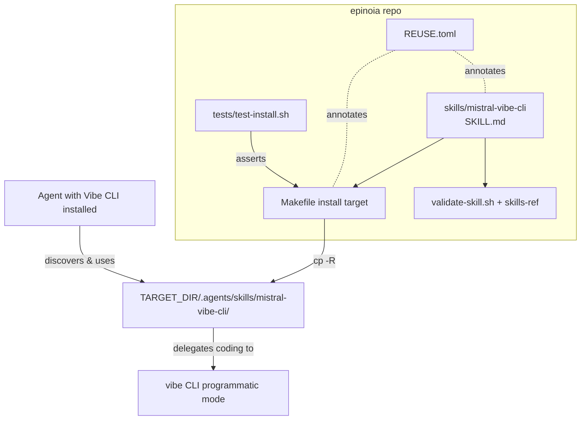

# Detailed Design: the `mistral-vibe-cli` agent skill

## Overview

This design turns the rough idea into concrete deliverables for the epinoia
repository: a new distributable agent skill at `skills/mistral-vibe-cli/` that
teaches agents how to delegate coding tasks to the Mistral Vibe CLI
(`vibe`, from https://github.com/mistralai/mistral-vibe), and an updated
`make install` target that installs it explicitly alongside the existing
skills. The skill is a functional port of the Hermes Agent `opencode` skill,
translated to the Vibe CLI's programmatic mode and to epinoia's SOP skill
format. No application code is written; the deliverables are Markdown, a
Makefile change, repository compliance metadata, and shell tests, all in
English.

## Detailed Requirements

Consolidated from the requirements clarification (recorded in the project's
`idea-honing.md`):

1. **R1 — Skill identity.** A skill directory `skills/mistral-vibe-cli/` with
   a `SKILL.md` whose YAML frontmatter has `name: mistral-vibe-cli`
   (lowercase, hyphen-separated, matching the directory, per
   https://agentskills.io/specification.md), a `description` (1–1024
   characters) describing both what the skill does and when to use it, and the
   optional spec fields `license: MIT` and `metadata` (author, version). A
   `compatibility` frontmatter field states the runtime requirement (the Vibe
   CLI, git).
2. **R2 — Spec compliance.** The skill passes the `skills-ref` Agent Skills
   specification validation (`uvx --from skills-ref agentskills validate`),
   the epinoia SOP structure validation
   (`.agents/skills/agent-sop-author/validate-skill.sh`: Overview,
   Parameters with "Constraints for parameter acquisition", numbered
   `### N.` steps with `**Constraints:**` blocks, RFC 2119 keywords,
   Examples, Troubleshooting, under 500 lines), and `uvx reuse lint`.
3. **R3 — Ported capabilities.** The skill documents, for the Vibe CLI:
   - Readiness verification (`vibe --version`, credentials).
   - One-shot bounded delegation via programmatic mode
     (`vibe --prompt`, `--prompt-file`, stdin) with bounds
     (`--max-turns`, `--max-tokens`, `--max-price`, `--time-limit`).
   - Approval semantics in programmatic mode: denied calls by default,
     `--auto-approve` for trusted runs, the `enable_auto_approve`
     admin override, and per-tool `permission`/allowlist fallbacks.
   - Agent and model selection (`--agent`, `--model`, `--thinking`), tool
     restriction (`--enabled-tools`/`--disabled-tools`), output formats
     (`--output text|json|streaming`), run artifacts (`--output-dir`
     `export.json`), and exit codes 0–3 with their meaning.
   - Session continuation (`--continue`, `--resume SESSION_ID`, with `-p`)
     and the session-logging prerequisite.
   - Folder trust in programmatic mode (`--trust`).
   - Parallel isolated work with `--worktree`.
   - A smoke verification and a pitfalls section with Vibe-specific failure
     modes.
  
   Hermes `opencode` capabilities with no Vibe equivalent (`pr` subcommand,
   `stats`, `session list`, TUI/PTY management) are documented as explicitly
   out of scope rather than invented.
4. **R4 — Makefile install target.** `make install` names the skills it
   installs in a single explicit list (an ordered `SKILLS` variable
   containing `codebase-summary`, `edenai-zed-config`, `pdd`,
   `ponytail-review`, `ponytail-review-pdd`, and `mistral-vibe-cli`), checks
   that every listed skill directory exists before copying (failing with a
   clear error otherwise), installs each into
   `TARGET_DIR/.agents/skills/`, and echoes the installed list. Placement
   rules are unchanged: skills go to `TARGET_DIR/.agents/skills/`, opencode
   files to the target's git root, `.vibe/` to `TARGET_DIR`.
5. **R5 — Tests.** `tests/test-install.sh` asserts, per installed skill:
   the `SKILL.md` lands in `TARGET_DIR/.agents/skills/<name>/SKILL.md`
   (including `mistral-vibe-cli`), and the new guard rejects a run when a
   listed skill directory is missing. Because the install target refuses to
   run against this repository itself, the guard is exercised through a
   temporary copy of the repository with one listed skill removed. The full hermetic suite (`make test`) still passes.
6. **R6 — Compliance.** `skills/mistral-vibe-cli/SKILL.md` is original
   demiourgoi content under MIT, added to the original-content
   `[[annotations]]` block in `REUSE.toml` together with the Makefile and
   test edits. No third-party text is embedded, so
   `THIRD-PARTY-NOTICES.md` needs no new entry. `uvx reuse lint` passes.
7. **R7 — Language.** All skill text, PDD artifacts, and code comments are
   in English.
8. **R8 — PDD record.** The PDD artifacts live under
   `.agents/planning/2026-11-26-mistral-vibe-cli/` and travel with the PR
   together with the implementation.

## Architecture Overview

epinoia is a repository of distributable agent skills and agent
configurations, with a Makefile-driven install and a hermetic shell test
suite. The change adds one node to the `skills/` tree and makes the install
target's skill set explicit:



The consumer flow: an agent that needs to delegate coding loads the installed
skill, follows its procedure to formulate the task and pick bounds, runs
`vibe --prompt ...` in the target repository, inspects the outcome (exit
code, stdout/JSON, `export.json`), verifies the produced changes with tests,
and iterates through session continuation if the first pass is incomplete.

## Components and Interfaces

### Component 1: `skills/mistral-vibe-cli/SKILL.md`

The skill body, written fresh against the official Vibe CLI documentation
(links in the research notes), has this interface:

- **Frontmatter** (spec fields): `name`, `description`
  ("Delegate coding tasks to the Mistral Vibe CLI..."; states triggers such
  as delegating implementation, refactoring, debugging, or review work),
  `license: MIT`, `compatibility` (requires the `vibe` CLI and git),
  `metadata` (`author: demiourgoi`, `version: "1.0.0"`).
- **## Overview** — what the skill does and when to use it.
- **## Parameters** — `coding_task` (required), `workdir` (required,
  default the repository root), `mode` (one-shot bounded or iterative
  continued session), `bounds` (optional turn/token/price/time caps),
  `model_kwargs` (optional `--model`, `--thinking`, `--agent`), and the
  acquisition constraints block required by the SOP format (ask once, up
  front; accept direct text or a file path).
- **## Steps** — numbered steps with Constraints:
  1. **Verify readiness** — `vibe --version`; confirm credentials
     (`MISTRAL_API_KEY` or keyring); confirm the folder trust story.
  2. **Compose the delegation prompt** — self-contained task statement,
     acceptance criteria, tests to run, files to touch, and where to write
     progress; prompt from `--prompt-file`/stdin for long or
     shell-problematic text.
  3. **Run a bounded one-shot task** — `vibe --prompt "..." --max-turns N
     [--auto-approve] [--output json] [--output-dir DIR]` in the workdir;
     choose `--agent`/approval posture; always bound the run.
  4. **Interpret the outcome** — exit codes 0/1/2/3; warnings on stderr;
     `export.json` for usage/cost/stop reason; re-run small instead of
     debugging inside the run.
  5. **Iterate on a session** — continue with `vibe --prompt ... --continue`
     or `--resume SESSION_ID`; note the session-logging prerequisite.
  6. **Run isolated parallel tasks** — one `--worktree` per task; programmatic
     runs leave worktrees in place.
  7. **Verify and report** — check the diff, run the project's tests, report
     files changed, results, and remaining risks.
- **## Pitfalls** — approvals denied silently in programmatic mode;
  `--auto-approve` may be admin-blocked; untrusted folder needs `--trust`;
  resumed sessions keep their old agent/model; Vibe has no `pr`/`stats`/
  `session list` equivalents (state the replacement patterns); `--worktree`
  consumes the next argument after a prompt.
- **## Examples** — a one-shot bounded run, a JSON run with an export, a
  continuation, a parallel worktree run, and the smoke check.
- **## Troubleshooting** — exit code meanings, missing credentials, prompt
  too long, denied tools, resume failures from disabled session logging.

### Component 2: Makefile install target

Today the recipe copies `$(REPO_DIR)/skills/.` wholesale. The new recipe:

```make
SKILLS := codebase-summary edenai-zed-config mistral-vibe-cli pdd \
    ponytail-review ponytail-review-pdd
```

- A pre-copy loop checks that `$(REPO_DIR)/skills/$$s` exists for every
  `$s` in `SKILLS`, printing the missing skill and exiting 2, so the list
  cannot silently drift from the tree.
- The copy loop replaces the single `cp -R skills/.` line and copies each
  listed skill into `$(TARGET_DIR)/.agents/skills/` with the same
  overwrite/others-untouched semantics.
- The success echo prints the installed skill list.
- Existing behavior is preserved: guards for missing/ repository-self
  `TARGET_DIR`, opencode files at the git root, `.vibe/` at `TARGET_DIR`,
  error message wording and exit codes.

### Component 3: `tests/test-install.sh` extensions

- New assertions after each `make install ...` run: every listed skill,
  including `mistral-vibe-cli`, has its `SKILL.md` installed.
- New group "install target: skill registry guard": copy the repo (sans
  `.git`) to a temp dir, drop a skill from `skills/` while it stays listed
  in the copied `Makefile`, run `make -C <copy> install TARGET_DIR=<dir>`,
  and assert exit code 2 with the missing-skill message. Copying the repo
  is needed because the recipe refuses to install into itself and reads
  from `REPO_DIR`, not the target.
- All tests stay hermetic (no network, no model calls).

### Component 4: `REUSE.toml` annotation

Only `skills/mistral-vibe-cli/SKILL.md` is a new file, so it is the only
path added to the original-content `[[annotations]]` block
(demiourgoi copyright, MIT license, the same standard fields the other
original files use). The `Makefile` and `tests/test-install.sh`
already appear in that block and need no change.

## Data Models

No runtime data model exists; the deliverables are text files and a shell
recipe. The two structured artifacts are:

- **SKILL.md frontmatter** (YAML): `name`, `description`, `license`,
  `compatibility`, `metadata` — validated by the Agent Skills spec rules.
- **`export.json`** (produced by the Vibe CLI at runtime, only referenced by
  the skill's instructions): stop reason, outcome, token usage, cost,
  subagent breakdown, `warnings`. The skill documents reading it; this design
  does not depend on its exact schema.

## Error Handling

- **Makefile**: any listed skill missing from `skills/` fails the install
  before copying, with exit code 2 and a message naming the skill, so partial
  installs cannot happen. All existing guards (unset/missing `TARGET_DIR`,
  self-install) keep their current messages and exit codes.
- **Skill instructions**: the skill tells the delegating agent to treat exit
  code 1 (bad flag/config), 2 (API/runtime failure), and 3 (limit reached or
  declined) differently: fix the invocation, fix credentials/billing, or
  resume with a bigger budget — and to capture stderr and `export.json`
  warnings before re-running.
- **Tests**: guard assertions use the suite's existing `run`/`assert_rc`/
  `assert_grep` helpers so failures print the offending output.

## Testing Strategy

- **Structure validation**: `.agents/skills/agent-sop-author/validate-skill.sh
  skills/mistral-vibe-cli` must exit 0 (it also runs the authoritative
  `skills-ref` validation).
- **Hermetic install tests**: `tests/test-install.sh` covers the monorepo
  fixture, the repository root, the default-PWD fallback, reinstall, every
  guard, plus the new assertions and the registry guard group.
- **Full suite**: `make test` (all `test-*.sh` suites, no network).
- **Compliance**: `uvx reuse lint` must pass on the tree.
- **Live smoke (not part of this deliverable's hermetic gate)**: the skill
  documents a `--max-turns`-bounded `vibe --prompt` smoke check for users
  with credentials; it is intentionally not automated because epinoia's
  default gate is hermetic.

## Appendices

### Appendix A: Technology Choices

- **Markdown SOP skill (no scripts/)**: the port needs a single
  `SKILL.md`. All delegation logic belongs to the calling agent's terminal
  tooling, so a `scripts/` directory would add unexercised surface. Verified
  structure only: frontmatter conventions, the fluent procedure counts as
  documentation.
- **Explicit `SKILLS` list in the Makefile** over the implicit
  `cp -R skills/.`: the requirement R4 asks the install target to name the
  skill; an explicit, guarded list makes the contract readable, fails loudly
  on drift, and costs one loop. Trade-off: adding a future skill needs a
  Makefile edit — accepted because the failure mode is an intentional,
  clear error.
- **No TUI/PTY guidance**: the Hermes skill's largest section manages a
  background OpenCode TUI with process tools; Vibe's programmatic mode makes
  that unnecessary, so the port documents `-c`/`--resume` continuation
  instead. This is both simpler and true to the Vibe CLI.
- **Fresh writing over literal porting**: the Hermes skill's prose targets
  Hermes' tool set; its facts (PTY, keybindings, `/exit`) don't apply to
  Vibe. Writing against the official Vibe docs avoids importing wrong facts
  and keeps the content original (planning decision Q6).

### Appendix B: Research Findings

- Programmatic mode is the delegation interface (`--prompt`/`-p`,
  `--prompt-file`, stdin) with documented bounds (`--max-turns`,
  `--max-tokens`, `--max-price`, `--time-limit`), outputs
  (`--output text|json|streaming`, `--output-dir`), agents (ask,
  accept-edits, smart-approve, auto-approve), trust (`--trust`), worktrees
  (`--worktree`), continuation (`--continue`, `--resume`), and exit codes
  0–3. Full findings with source links are in the research notes: Vibe CLI
  capabilities (docs.mistral.ai), the Hermes skill analysis and the
  OpenCode-to-Vibe capability mapping.
- The epinoia skill validator enforces the SOP layout (Overview, Parameters
  with constraints, numbered steps with Constraints) on top of the Agent
  Skills spec frontmatter rules, so the port must be restructured, not
  transcribed.
- Install placement: skills go to `TARGET_DIR/.agents/skills/` (Zed
  discovery) — unchanged by this design.

### Appendix C: Alternative Approaches

1. **Keep the implicit `cp -R skills/.` and change nothing.** Rejected: the
   requirement explicitly asks the install target to be updated for the new
   skill; keeping it implicit leaves the Makefile silent about what it ships.
2. **Copy the Hermes skill verbatim and s/opencode/vibe/.** Rejected: the
   CLI facts differ (no `pr`, no TUI management, different flags), the body
   would fail epinoia's structural validation, and a literal port would
   entangle third-party attribution for content that must change anyway
   (planning decision Q2/Q6). This design ports the capability set, not the
   document.
3. **Put the skill in `.agents/skills/` (development-only tree).**
   Rejected: the skill is meant to be distributed into target projects, so
   it belongs in the distributable `skills/` tree.
4. **Add helper scripts (e.g. wrapper scripts around common `vibe` invocations).**
   Rejected: no logic in this port is stable enough across products to be a
   script; terminal tools vary across agents, so the instructions must stay
   in prose. The ponytail principle applies: don't remove prose from a
   document whose value is its prose.
