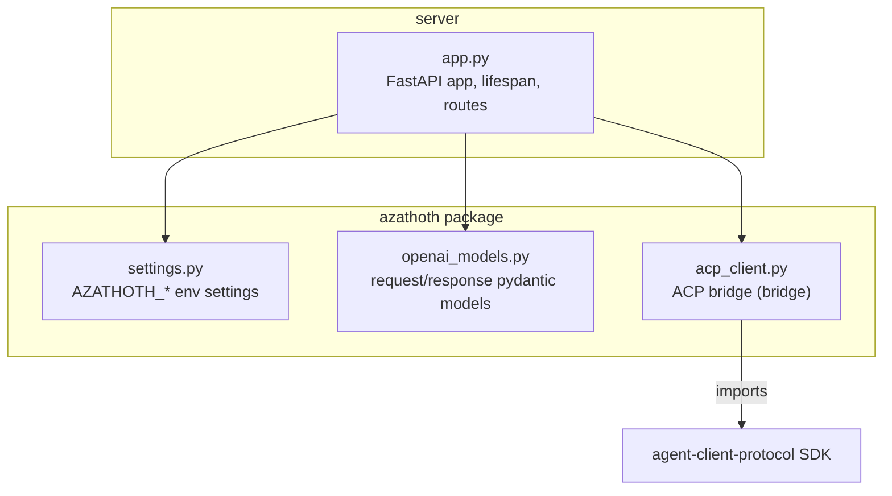

# Azathoth — Detailed Design

## Overview

Azathoth is a localhost-only HTTP service that exposes an **OpenAI-compatible
chat completions API** (`POST /v1/chat/completions`) and answers it by
prompting an **Agent Client Protocol (ACP) agent** over stdio, with **all
agent tools disabled**. The default agent server is `vibe-acp`, the ACP
server shipped with the Mistral Vibe CLI; any ACP agent binary can be used.

The service is packaged as a Python 3.14 uv project in `azathoth/`, following
the layout of
[demiourgoi/Harold's harold-mcp](https://github.com/demiourgoi/Harold/tree/main/harold-mcp)
(src layout, pydantic-settings, Makefile, ruff/mypy/pytest, unit vs
integration test split).

```
OpenAI client  ──HTTP──▶  azathoth (FastAPI, 127.0.0.1)  ──ACP/stdio──▶  agent (vibe-acp)
```

```mermaid
flowchart LR
    C[OpenAI-compatible client] -->|POST /v1/chat/completions| G[localhost guard]
    G --> V[Request validation\npydantic model]
    V --> S[ACP bridge]
    S -->|new session\nmcp_servers: []| A[vibe-acp / ACP agent]
    A -->|AgentMessageChunk updates| S
    S --> R[OpenAI response builder\nchat.completion / SSE chunks]
    R --> C
```

## Detailed Requirements

1. **R1 — OpenAI-compatible endpoint.** `POST /v1/chat/completions` accepts a
   JSON body with `model` (required, string) and `messages` (required,
   non-empty list of `{role, content}`); unknown extra fields are accepted
   and ignored, except `tools`/`tool_choice` which are rejected. The response
   body matches the OpenAI `chat.completion` schema (`id`, `object`,
   `created`, `model`, `choices[0].message`, `finish_reason`, `usage`).
2. **R2 — Chat completions only.** No other OpenAI endpoints exist. Any other
   path returns a `404` with an OpenAI-style error object.
3. **R3 — Streaming.** `stream: true` returns `text/event-stream` with
   `chat.completion.chunk` events and a final `data: [DONE]` line;
   `stream: false` (default) returns the full completion.
4. **R4 — Localhost only.** The server binds `127.0.0.1` by default
   (`AZATHOTH_HOST`); every request's client address must be an IP loopback
   address, otherwise the server responds `403` with an OpenAI-style
   `permission_error`. The operator may still bind e.g. `::1`, but never a
   non-loopback default.
5. **R5 — ACP agent invocation.** The agent server is launched as a child
   process (`AZATHOTH_ACP_COMMAND`, default `vibe-acp`; `AZATHOTH_ACP_ARGS`
   for arguments), connected once at startup via the official
   `agent-client-protocol` Python SDK, ACP protocol version 1.
6. **R6 — All tools disabled.** The bridge's ACP client: creates sessions
   with `mcp_servers: []`; denies every `session/request_permission`;
   declines every elicitation; answers `fs/write_text_file`, `fs/read_text_file`
   and all `terminal/*` requests with JSON-RPC method-not-found. No request
   can make the agent run a tool, read/write files, or spawn terminals through
   the client.
7. **R7 — Message translation.** Each request opens a fresh ACP session. The
   `messages` array is flattened into one prompt: the last system message
   and prior turns become a labeled transcript prelude, terminated by the
   final user message rendered as the actual prompt content. Assistant text
   chunks received from the agent are concatenated in order into the
   response (non-streaming) or forwarded as they arrive (streaming).
8. **R8 — Model selection.** The requested `model` is echoed in the response.
   If the agent's `session/new` advertises a `model` config option containing
   the requested value, the bridge selects it with `session/set_config_option`
   before prompting; `max_tokens`, when given, is likewise applied to the
   agent's `max_tokens` config option when advertised.
9. **R9 — Expected OpenAI errors.** Validation failures return `400`
   (`invalid_request_error`); upstream ACP failures return `502`
   (`api_error`); loopback violations `403` (`permission_error`); unhandled
   server faults `500` (`api_error`). All error bodies use the
   `{"error": {"message", "type", "param", "code"}}` OpenAI shape.
10. **R10 — README.** The `azathoth/README.md` documents installation, run
    instructions, configuration variables, and — per the requirements — how
    to install and authenticate the Vibe CLI and use `vibe-acp` as the ACP
    agent server, including a tools-disabled `.vibe` agent definition.
11. **R11 — Project conventions.** Python 3.14 uv project (src layout,
    pinned `.python-version`), FastAPI + uvicorn + `agent-client-protocol` +
    `pydantic-settings` runtime deps, ruff/mypy/pytest/deptry dev deps,
    Makefile with `install`/`check`/`test`/`test-unit`/`test-integration`/`run`
    targets, hermetic unit tests plus opt-in integration tests against a real
    `vibe-acp`.

## Architecture Overview

Three modules inside `src/azathoth/`, layered bottom-up:



- `settings.py` — a `pydantic-settings` `BaseSettings` class reading
  `AZATHOTH_HOST`, `AZATHOTH_PORT`, `AZATHOTH_ACP_COMMAND`,
  `AZATHOTH_ACP_ARGS`, `AZATHOTH_TIMEOUT_SECS`.
- `openai_models.py` — request validation and response construction; pure
  data mapping with no I/O, fully unit-testable.
- `acp_client.py` — `ToolsDisabledClient(Client)` implementing the deny-always
  policy, and an async `AcpBridge` context manager owning the agent
  subprocess and connection: `initialize()` at startup, `complete(request)`
  per chat request (new session, optional config-option selection, prompt,
  accumulate), and reconnect-on-death.
- `app.py` — the FastAPI application: lifespan starts/stops the bridge, a
  dependency enforces the loopback client-address rule, the route validates
  the request body and produces either the JSON or SSE response. A `run()`
  function reads settings and calls `uvicorn.run`.

## Components and Interfaces

### Settings (`settings.py`)

```python
class Settings(BaseSettings):
    model_config = SettingsConfigDict(env_prefix="AZATHOTH_")
    host: str = "127.0.0.1"
    port: int = 8000
    acp_command: str = "vibe-acp"
    acp_args: list[str] = []
    timeout_secs: float = 600.0
```

### OpenAI models (`openai_models.py`)

- `ChatCompletionRequest`: `model: str`, `messages: list[ChatMessage]`,
  `stream: bool = False`, `max_tokens: int | None`. Extra fields allowed.
- `ChatMessage`: `role: Literal["system","user","assistant","tool"]`,
  `content: str`. Tool-call and multimodal contents are out of scope
  (R1/R6): a `tools` field on the request triggers validation failure.
- Builders `build_completion(...)`, `build_chunk(...)` and
  `error_response(...)` produce the wire payloads in R1/R3/R9.

### ACP bridge (`acp_client.py`)

```python
class ToolsDisabledClient(Client):
    # R6: deny permissions, decline elicitation, method-not-found for
    # fs/terminal hooks; session_update feeds a per-request queue.

class AcpBridge:
    async def start(self) -> None            # spawn + initialize
    async def stop(self) -> None
    async def complete(self, request: ChatCompletionRequest) -> CompletionResult
    # -> (streamed text pieces, stop_reason)
```

`complete()` per call: `new_session(cwd, mcp_servers=[])` → apply
`model`/`max_tokens` config options when advertised → subscribe a queue to
that session's updates → `prompt(flattened transcript)` → drain
`AgentMessageChunk` text until `PromptResponse` → return the joined text and
`stop_reason`. The map from ACP stop reason to OpenAI `finish_reason` lives
next to the OpenAI builders. The single `ToolsDisabledClient.session_update`
callback demultiplexes updates by `session_id` into per-request queues, so
concurrent requests on the shared connection cannot cross streams.

### HTTP app (`app.py`)

- `GET /health` — minimal liveness (returns `{"status": "ok"}`); also used by
  tests. Not part of the OpenAI surface.
- `POST /v1/chat/completions` — the only OpenAI route.
- FastAPI's default validation error handler is overridden so malformed
  bodies also return the OpenAI error shape.
- Lifespan owns the single `AcpBridge`; the bridge is shared by concurrent
  requests (ACP multiplexes sessions over one connection).

## Data Models

Request/response JSON is dictated by the OpenAI schema (R1, R3, R9). The
internal `CompletionResult` carries `text`, `stop_reason`, and the streamed
text fragments. ACP wire objects (sessions, updates, permission options) are
the SDK's pydantic models reused directly — no parallel schema is defined.

## Error Handling

| Condition | Status | Error type |
| --- | --- | --- |
| Non-loopback client address | 403 | `permission_error` |
| Missing/invalid `model`/`messages`, `tools` present, empty messages | 400 | `invalid_request_error` |
| Agent process cannot start or died mid-request and reconnect fails | 502 | `api_error` |
| ACP request times out (`AZATHOTH_TIMEOUT_SECS`) | 502 | `api_error` |
| Refusal stop reason from agent | 200 | `finish_reason: "content_filter"` |
| Unhandled exception | 500 | `api_error` |

The loopback check runs before body parsing. A timeout cannot reliably stop an
agent-side turn (the SDK offers no session cancel), so on timeout the bridge
is marked unhealthy: the agent connection is reopened before the next
request and the current request fails with `502`. The package version is read
via `importlib.metadata` (no `metadata.py` module).

## Testing Strategy

- **Unit (hermetic, default)**: request/response mapping (builders, error
  shape, finish-reason mapping), loopback guard (TestClient with overridden
  client address), flattening of message transcripts, and the full request
  path against a **fake ACP agent**: an in-process `connect_agent`
  SDK-based agent script spawned through `sys.executable` that echoes canned
  `AgentMessageChunk` updates and exercises permission denial — so tests
  never require `vibe-acp`, network, or tokens (repo rule: hermetic suites
  must not touch the network).
- **Integration (opt-in)**: `tests/integration` skips unless
  `AZATHOTH_INTEGRATION_ACP_COMMAND` is set; a live run points it at a real
  `vibe-acp` and asserts the full round trip.
- **Quality gates**: `make check` (ruff, mypy, deptry) and `make test` from
  `azathoth/`.

## Appendices

### A. Technology choices

- **FastAPI + uvicorn** (requested): async fits ACP's asyncio SDK, pydantic
  models align with the SDK, SSE is a first-class streaming response.
- **`agent-client-protocol` SDK**: mirrored schema models and both-sides
  base classes enable the client policy and the test fake. Current release
  line is used (`>=1.0`); Vibe's own pin (`0.11.0`) speaks the same protocol
  version 1 on the wire.
- **pydantic-settings for configuration**, following harold-mcp.

### B. Existing solutions considered

- Pydantic AI's ACP harness (pydantic.dev/docs/ai/harness/acp/) is oriented
  to exposing *pydantic-ai agents as ACP agents* for UI testing — the wrong
  direction for azathoth (we are the client), though its harness informed
  the fake-agent test approach.
- LiteLLM-style multiproxies add provider routing we do not need; azathoth
  proxies exactly one agent.

### C. Alternatives rejected

- **One ACP session per chat conversation** (stateful mapping): requires
  session bookkeeping keyed by conversation ids, which the OpenAI API does
  not carry; stateless session-per-request (R7) is simpler and safer.
- **Long-lived session reuse for consecutive requests**: risks cross-request
  context leakage; rejected.
- **Server-side-only tool disabling via `.vibe` agent config**: kept in the
  README as recommended hardening, but the client-side policy (R6) is the
  enforced guarantee because the proxy cannot trust the agent install to be
  configured.
