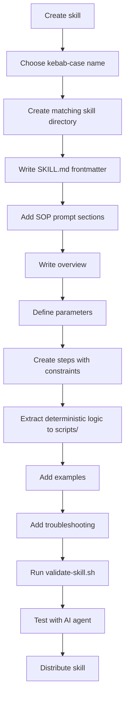

# Agent SOP Author

## Overview

Agent SOPs (Standard Operating Procedures) are natural-language workflows that guide AI agents through sophisticated tasks using parameterized inputs and constraint-based execution. This skill teaches you how to package such workflows as **agent skills**: self-contained directories that bundle the SOP prompt with executable scripts and other resources, in the open [Agent Skills format](https://agentskills.io) that works across different AI systems (Claude, Kiro, Cursor, Zed, etc.).

The authoritative format reference is bundled alongside this skill: see [assets/agent-skills-specification.md](assets/agent-skills-specification.md). When in doubt about the format, consult it.

## Usage

When working with agent skills and need to:
- Create or update workflow automation skills
- Structure multi-step agent workflows with RFC 2119 constraints (MUST, SHOULD, MAY)
- Extract deterministic logic into scripts
- Validate skills against the Agent Skills specification
- Consolidate an existing agent thread into a reusable skill

## Core Concepts

### What does this skill generate?

An agent skill is a directory containing, at minimum, a `SKILL.md` file:

```
skill-name/
├── SKILL.md          # Required: YAML frontmatter + SOP prompt body
├── scripts/          # Deterministic logic (bash preferred, else python3)
├── references/       # Optional: load-on-demand documentation
└── assets/           # Optional: templates and static resources
```

The `SKILL.md` file combines:
- **Agent Skills frontmatter** (`name`, `description`, ...) used for discovery and format validation
- **SOP prompt body** with clear objectives, parameterized inputs, step-by-step instructions with RFC 2119 constraints, and examples and troubleshooting for reliable execution

### Key Features

**RFC 2119 Constraints**: Use standardized keywords (MUST, SHOULD, MAY) to provide precise control over agent behavior without rigid scripting.

**Parameterization**: Accept parameters that customize behavior for different projects, teams, or requirements.

**Resumability**: Document progress as agents work, making it easy to understand and resume if interrupted.

**Deterministic scripts**: Anything that can be computed or checked exactly (validation, parsing, formatting, scaffolding) belongs in `scripts/`, not in prose. The prompt tells the agent *when* and *why* to run a script; the script does the work.

**Progressive disclosure**: Agents load only the `name` and `description` at startup, the full `SKILL.md` on activation, and other files on demand. Keep `SKILL.md` under 500 lines and move detail to `references/`.

## Creating Agent Skills

### File Location

You **MUST** check where skills live in the current project before creating one:
- Repositories commonly keep development skills in `.agents/skills/` and distributable skill artifacts in `skills/`
- If a skills directory exists, You **MUST** create the new skill directory there
- If no skills directory exists, You **MAY** ask the user where to create it

### Naming

You **MUST** follow these naming conventions:
- The skill directory name and the frontmatter `name` **MUST** be identical
- Use kebab-case: lowercase letters, numbers, and hyphens only; no leading, trailing, or consecutive hyphens; maximum 64 characters (e.g., `code-assist`, `idea-honing`)
- Choose descriptive names that indicate the skill's purpose

### Frontmatter

The `SKILL.md` **MUST** start with a YAML frontmatter block. Fields per [assets/agent-skills-specification.md](assets/agent-skills-specification.md):

| Field | Required | Constraints |
|-------|----------|-------------|
| `name` | Yes | Max 64 chars; lowercase letters, numbers, hyphens; must match the directory name |
| `description` | Yes | Max 1024 chars; describes what the skill does and when to use it |
| `license` | No | License name or reference to a bundled license file |
| `compatibility` | No | Max 500 chars; environment requirements (only if needed) |
| `metadata` | No | Map of string keys to string values (e.g., `version`, `tags`) |
| `allowed-tools` | No | Space-separated pre-approved tools (experimental) |

You **MUST** write `description` so agents can discover the skill: state what it does and when to use it, including specific keywords.

### Validation

**You MUST run validate-skill.sh after EVERY change:**

The validation script is located in the same directory as this SKILL.md file. When you read this skill, you will know the full path to SKILL.md, and the validation script is in that same directory.

```bash
<skill-directory>/validate-skill.sh path/to/skill-name
```

The script checks the frontmatter and the SOP prompt structure, and then runs the authoritative Agent Skills specification validation:

```bash
UV_CACHE_DIR=/tmp/uv-cache UV_TOOL_DIR=/tmp/uv-tools UV_TOOL_BIN_DIR=/tmp/uv-bin uvx --from skills-ref agentskills validate path/to/skill-name
```

Note: the `uvx` call downloads the `skills-ref` package on first run, so it needs network access (or a warm `uv` cache).

You **MUST** fix all errors (❌) before proceeding. You **SHOULD** address warnings (⚠️) when possible.

### Required Structure

Every generated `SKILL.md` **MUST** include YAML frontmatter followed by these sections in order:

```markdown
---
name: skill-name
description: What this skill does and when to use it, with discovery keywords.
metadata:
  version: "1.0.0"
---

# [Skill Title]

## Overview
[Concise description of what the skill does and when to use it]

## Parameters

- **required_param** (required): Description
- **optional_param** (optional, default: "value"): Description

**Constraints for parameter acquisition:**
- If all required parameters are already provided, You MUST proceed to the Steps
- If any required parameters are missing, You MUST ask for them before proceeding
- When asking for parameters, You MUST request all parameters in a single prompt
- When asking for parameters, You MUST use the exact parameter names as defined

## Steps
### 1. [Step Name]
Description of what happens in this step.

**Constraints:**
- You MUST [specific requirement]
- You SHOULD [recommended behavior]
- You MAY [optional behavior]

## Examples
[Concrete usage examples]

## Troubleshooting
[Common issues and solutions]
```

### Scripts

You **MUST** place deterministic logic in the `scripts/` directory rather than describing it as prose steps, as indicated in the Agent Skills specification. Deterministic logic is anything with a single correct outcome: validation, parsing, formatting, computation, or scaffolding where the agent should not improvise.

**Language choice:**
- You **SHOULD** write scripts in bash, keeping them portable: You **MUST NOT** assume any specific command is installed — guard every non-builtin command with `command -v` and print a helpful error message when it is missing
- You **SHOULD** use python3 when the logic exceeds what bash can express portably (structured data, date math, encoding, ...): keep it self-contained with the standard library only, include helpful error messages, and handle edge cases gracefully

**Example bash guard pattern:**

```bash
if ! command -v jq >/dev/null 2>&1; then
    echo "Error: jq is required but not installed. Install jq or use scripts/sum-fields.py instead." >&2
    exit 1
fi
```

**You MUST** follow these rules for `scripts/`:
- Reference scripts from `SKILL.md` with relative paths (e.g., `scripts/extract.sh`), one level deep
- Make scripts executable and self-contained, or clearly document their dependencies
- Write steps that tell the agent when to run each script and what to do with its output; the reasoning stays in the prompt, the mechanics stay in the script

### Parameters Section

You **MUST** define parameters using this format:

```markdown
## Parameters

- **parameter_name** (required): Description of required input
- **another_param** (required): Description
- **optional_param** (optional): Description of optional input
- **with_default** (optional, default: "default_value"): Description

**Constraints for parameter acquisition:** [four mandatory directives, listed below]
```

**Parameter naming rules:**
- You **MUST** use lowercase letters
- You **MUST** use underscores for spaces (snake_case)
- You **MUST** be descriptive of purpose
- You **MUST** list required parameters before optional ones

**The Constraints for parameter acquisition section:**
- You **MUST** include this section in every Parameters section
- You **MUST** include these directives:
  - "If all required parameters are already provided, You MUST proceed to the Steps"
  - "If any required parameters are missing, You MUST ask for them before proceeding"
  - "When asking for parameters, You MUST request all parameters in a single prompt"
  - "When asking for parameters, You MUST use the exact parameter names as defined"
- You **MAY** add additional constraints for flexible input methods:

```markdown
**Constraints for parameter acquisition:**
- [the four mandatory directives from above]
- You MUST support multiple input methods including:
  - Direct input: Text provided directly
  - File path: Path to a local file
  - URL: Link to an internal resource
- You MUST use appropriate tools to access content
- You MUST confirm successful acquisition before proceeding
- You SHOULD save acquired data to a consistent location
```

### Steps Section

You **MUST** structure steps with:
1. Numbered heading (### 1., ### 2., etc.)
2. Step name
3. Natural language description
4. **Constraints:** section with RFC 2119 keywords

**Example:**

```markdown
### 1. Setup
Initialize the project environment and create necessary structures.

**Constraints:**
- You MUST validate directory structure exists
- You MUST create missing directories
- You MUST NOT proceed if directory creation fails, because a partial setup corrupts later steps
- You SHOULD log all setup actions
- You MAY skip validation if --force flag is provided
```

**For conditional logic:**

```markdown
### 3. Conditional Processing
If validation passes, proceed with processing. Otherwise, report errors.

**Constraints:**
- You MUST check validation status before proceeding
- If validation passes, You MUST process the data
- If validation fails, You MUST report specific errors
- You MUST NOT continue with invalid data
```

**For deterministic operations, run a script instead of describing the mechanics:**

```markdown
### 2. Summarize Metrics
Run the summarization script over the collected reports.

**Constraints:**
- You MUST run scripts/summarize.sh <report-dir>
- You MUST NOT reimplement the summarization in the conversation, because the script is the reviewed source of truth
```

### RFC 2119 Keywords

You **MUST** use these keywords as defined in RFC 2119:

- **MUST** / **REQUIRED**: Absolute requirement
- **MUST NOT** / **SHALL NOT**: Absolute prohibition
- **SHOULD** / **RECOMMENDED**: Strong recommendation (may have valid reasons to ignore)
- **SHOULD NOT** / **NOT RECOMMENDED**: Strong discouragement (may have valid reasons to accept)
- **MAY** / **OPTIONAL**: Truly optional item

### Negative Constraints

You **MUST** provide context when using negative constraints:

**Good (with context):**
```markdown
- You MUST NOT use ellipses (...) because your output will be read aloud by text-to-speech
- You SHOULD NEVER delete Git history files since this could corrupt the repository
- You MUST NOT run `git push` because this could publish unreviewed code
```

**Bad (without context):**
```markdown
- You MUST NOT use ellipses
- You SHOULD NEVER delete Git files
- You MUST NOT run git push
- You MUST NOT run `git push` because this could publish unreviewed code
```

### RFC 2119 Keywords
### Examples Section

You **SHOULD** include concrete examples showing:
- Example input parameters
- Expected output or behavior
- Common usage patterns

```markdown
## Examples

### Example 1: Basic Usage
**Input:**
- task_description: "Create user authentication system"
- mode: "interactive"

**Expected Behavior:**
Agent will guide through TDD workflow, creating tests first, then implementation.

### Example 2: Automated Mode
**Input:**
- task_description: "Fix bug in payment processing"
- mode: "auto"

**Expected Behavior:**
Agent will automatically implement fix following established patterns.
```

### Troubleshooting Section

You **SHOULD** include common issues and solutions:

```markdown
## Troubleshooting

### Parameter Validation Fails
If parameter validation fails, check that:
- All required parameters are provided
- Parameter names use snake_case
- Values match expected types

### Step Execution Hangs
If a step appears to hang:
- Check for missing tool permissions
- Verify file paths are accessible
- Review constraint requirements
```

## Interactive Skills

For skills requiring user interaction:

1. You **SHOULD** clearly indicate when user interaction is expected
2. You **MUST** specify how to handle user responses
3. You **SHOULD** specify where to save interaction records

**Example:**

```markdown
### 2. Requirements Clarification
Guide the user through questions to refine their initial idea.

**Constraints:**
- You MUST ask one question at a time
- You MUST append each Q&A to "idea-honing.md"
- You SHOULD adapt follow-up questions based on previous answers
- You MUST continue until sufficient detail is gathered
```

## Best Practices

You **SHOULD** follow these practices when authoring skills:

1. **Keep steps focused**: Each step should accomplish one clear objective
2. **Use clear constraints**: Be specific about requirements vs recommendations
3. **Prefer scripts over prose**: Any deterministic operation belongs in `scripts/`; the prompt keeps only judgment calls
4. **Provide examples**: Show concrete usage for complex workflows
5. **Natural language**: Write descriptions that are easy to understand
6. **Minimize complexity**: Avoid deeply nested conditional logic
7. **Specify artifacts**: Include file paths for all created artifacts
8. **Keep SKILL.md under 500 lines**: Move detailed reference material to `references/`
9. **Test thoroughly**: Validate skills work across different AI systems
10. **Document edge cases**: Include troubleshooting for common issues

## Quick Reference

| Element | Format | Required |
|---------|--------|----------|
| Directory | `skill-name/` in kebab-case, matching `name` | Yes |
| Skill file | `SKILL.md` with YAML frontmatter | Yes |
| Frontmatter `name` / `description` | name: kebab-case, max 64 chars, matches directory; description: max 1024 chars, what + when | Yes |
| Title | `# Skill Name` | Yes |
| Overview | `## Overview` | Yes |
| Parameters | `## Parameters` | Yes |
| Steps | `## Steps` with `### N.` | Yes |
| Constraints | `**Constraints:**` with RFC 2119 | Yes |
| Scripts | `scripts/*.sh` or `scripts/*.py` | When deterministic logic exists |
| Examples | `## Examples` | Recommended |
| Troubleshooting | `## Troubleshooting` | Recommended |
| Body length | Under 500 lines | Recommended |

## Common Patterns

### Before: Unstructured Prompt
```markdown
Please implement a user authentication system using TDD.
Make sure to write tests first and follow best practices.
```

### After: Structured Skill
```markdown
---
name: code-assist
description: Guide implementation of coding tasks using test-driven development. Use when implementing a feature or fixing a bug with tests written first.
metadata:
  version: "1.0.0"
---

# Code Assist

## Overview
This skill guides implementation using test-driven development.

## Parameters
- **task_description** (required): Description of task
- **mode** (optional, default: "interactive"): "interactive" or "auto"

**Constraints for parameter acquisition:** [the four mandatory directives]

## Steps
### 1. Setup
Initialize project environment.

**Constraints:**
- You MUST validate directory structure
- You MUST create test directory if missing
- You MUST NOT proceed if setup fails, because later steps assume the layout

### 2. Test Creation
Create tests based on requirements.

**Constraints:**
- You MUST write tests before implementation
- You SHOULD follow existing test patterns
- You MAY add additional edge case tests
```

## Common Mistakes

### Deterministic Logic in Prose
**Problem:** A step instructs the agent to "parse the report and sum the totals" — something an agent can silently get wrong.
**Fix:** Write `scripts/sum-totals.sh` (or `.py`) and make the step run it.

### Bash Assuming Missing Commands
**Problem:** A script calls `jq` or `yq` unguarded, and fails with a confusing error on machines without it.
**Fix:** Guard with `command -v` and print what to install, or fall back to a python3 script.

### Missing Context in Negative Constraints
**Problem:** Using MUST NOT without explaining why.
**Fix:** Always provide context: "You MUST NOT X because Y"

### Frontmatter Not Matching the Directory
**Problem:** `name: code-assist` inside `code_assist/` — the skill fails specification validation.
**Fix:** Keep directory name and `name` identical, in kebab-case.

### Vague Parameter Descriptions
**Problem:** "input_data (required): The data"
**Fix:** "input_data (required): JSON object containing user profile fields (name, email, role)"

### Mixing Requirement Levels
**Problem:** Using MUST for optional behaviors or MAY for critical requirements.
**Fix:** Use RFC 2119 keywords precisely - MUST for absolute requirements, SHOULD for recommendations, MAY for optional.

### Missing Examples
**Problem:** Complex workflow without concrete usage examples.
**Fix:** Include at least one complete example showing input parameters and expected behavior.

### Overly Complex Steps
**Problem:** Single step trying to accomplish multiple objectives with nested conditionals.
**Fix:** Break into multiple focused steps, each with clear constraints.

### Bloated SKILL.md
**Problem:** A 900-line SKILL.md that burns the agent's context window on activation.
**Fix:** Keep the prompt under 500 lines; move detail to `references/` files loaded on demand.

## Visual Workflow



## The Bottom Line

Agent skills transform complex workflows into reusable, shareable packages that work across different AI systems: an SOP-style prompt (parameters, numbered steps, RFC 2119 constraints) in a `SKILL.md` with Agent Skills frontmatter, deterministic logic extracted into `scripts/`, and validation against the Agent Skills specification.

When creating skills, focus on correct frontmatter, clear structure, specific constraints with context, scripts for anything deterministic, and concrete examples. Validate after every change and test thoroughly across different AI systems to ensure reliability.
