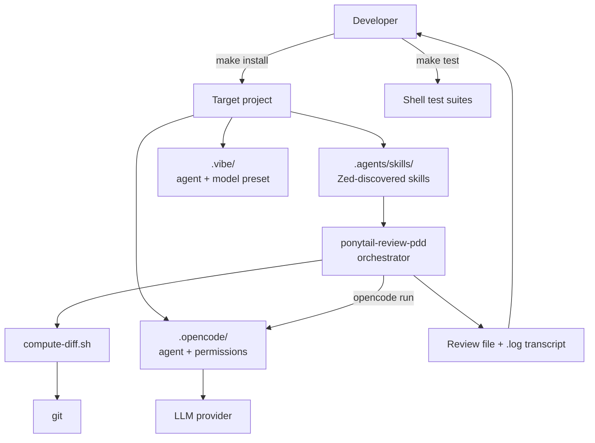

# Architecture

<!-- tags: architecture, design, layers -->

## High-level structure

Epinoia is a distribution of agent skills plus the glue that makes one skill (PDD review) safe to run unattended. There is no server, build, or package. The repository has four layers:

1. **Artifact layer** — Markdown skills and agent definitions, copied into target projects by `make install`.
2. **Orchestration layer** — Bash scripts in `skills/ponytail-review-pdd/scripts/` that validate parameters, compute diffs, choose revision numbers, build prompts, and run opencode.
3. **Enforcement layer** — opencode permissions (`.opencode/opencode.json`) and the opencode/Vibe agent prompts restrict the reviewer to read-only work plus one named review file.
4. **Verification and compliance layer** — shell test suites under `tests/`, plus REUSE annotations and third-party notices.

## Execution surfaces

| Surface | How it discovers configuration | What epinoia installs |
| --- | --- | --- |
| Zed | Project skills under `<project>/.agents/skills/` | Every directory in `skills/` |
| opencode | `.opencode/` searched upward from the working directory; the review script runs opencode at the git root | `.opencode/agents/ponytail-review-readonly.md` and `.opencode/opencode.json` at the target's git root |
| Mistral Vibe | The closest `.vibe/` walking up from the working directory | `.vibe/config.toml` and `.vibe/agents/ponytail-reviewer.toml` at `TARGET_DIR` |

The split placement is deliberate: the opencode review session starts at the repository root, so its files must live there; Vibe starts in the project directory, so its files go to `TARGET_DIR`.

## Design principles

- **Deterministic work in scripts.** Validation, diff computation, revision numbering, path resolution, and opencode invocation are Bash, not prose. A `SKILL.md` only tells the agent when and why to call them.
- **Single source of truth for the model.** `run-review.sh` reads the default model and reasoning-effort variant from the reviewer agent's `model:` frontmatter. Tests rewrite that line to prove nothing is hardcoded.
- **Read-only by construction.** The reviewer is constrained twice: the agent prompt forbids edits except the named review file, and opencode permissions deny edits and shell commands outside an allowlist. The orchestrator never passes `--auto`.
- **Artifacts travel with attribution.** Verbatim third-party skills stay byte-identical and carry a `LICENSE` sidecar; modified derivatives keep the upstream license and state their changes.
- **Hermetic tests by default.** Suites that need network or model calls are named `test-e2e*` and skipped unless `--e2e` is passed. The full `run-review.sh` path is exercised with a stubbed `opencode` binary.
- **Progressive disclosure.** Distributable skills keep `SKILL.md` concise; deterministic behavior lives in scripts and detail in references or the knowledge base.

## Failure containment

- `run-review.sh` validates everything before launching opencode: subject, parameter combinations, PDD artifacts, agent installation, and permissions configuration.
- On failure it prints an actionable error to stderr and exits non-zero. The launching agent must not retry with hand-written flags.
- opencode's console output is redirected to a `.log` file; only the review file is printed to stdout. A noisy or truncated transcript cannot swallow the report.
- After opencode exits, the script checks that the review file exists and is non-empty. Otherwise it fails and prints the transcript tail.

## What this architecture does not include

- No background service, daemon, database, or cache.
- No build step or generated code (the knowledge base is generated documentation, not a build artifact).
- No CI configuration inside this directory; any workflow files would live at the repository's git root, outside the package.
