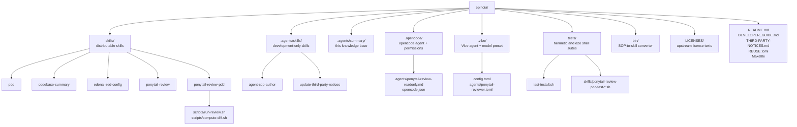

# Codebase Information

<!-- tags: overview, metadata -->

## Identity

- **Name**: epinoia
- **Purpose**: Internal development tools for demiourgoi. Ships reusable agent skills and agent configurations, and orchestrates read-only reviews of Prompt-Driven Development (PDD) artifacts.
- **Kind**: A collection of Markdown skills, shell scripts, and agent/config files. There is no application binary, package build, or runtime service.
- **License**: Original content is MIT. Bundled third-party content keeps its upstream license (Apache-2.0, MIT, or CC-BY-4.0). See `THIRD-PARTY-NOTICES.md` and `REUSE.toml`.

## Technology stack

| Area | Technology |
| --- | --- |
| Executable logic | Bash (bash 4+), `set -euo pipefail` in scripts |
| Skill format | Agent Skills: a directory with `SKILL.md` (YAML frontmatter + SOP body) and optional `scripts/`, `references/`, `assets/` |
| opencode | Markdown agent definitions with YAML frontmatter; JSON configuration (`opencode.json`) |
| Mistral Vibe | TOML model configuration (`config.toml`) and agent definitions (`agents/*.toml`) |
| Task automation | `Makefile` targets: `install`, `test`, `test-e2e`, `help` |
| Compliance | REUSE Specification (`REUSE.toml`, `LICENSES/`) validated with `uvx reuse lint` |
| Auxiliary tooling | `uvx` (`reuse`, `strands-agents-sops`, `skills-ref`), `git`, `opencode` |
| Documentation | Markdown, rendered by the consuming agent/editor; Mermaid for diagrams |

There are no Python, Node, Go, or compiled application sources and no dependency lockfile. `python3`, `realpath`, and `uuidgen` are optional helpers used by scripts when present.

## Directory map

## Two skill trees

| Tree | Audience | Contents |
| --- | --- | --- |
| `skills/` | Distributable artifacts copied into target projects by `make install` | `pdd`, `codebase-summary`, `edenai-zed-config`, `ponytail-review`, `ponytail-review-pdd` |
| `.agents/skills/` | Development of this repository only | `agent-sop-author`, `update-third-party-notices` |

`make install` copies `skills/`; it never installs `.agents/skills/`.

## Entry points

| Entry point | Role |
| --- | --- |
| `Makefile` | `install`, `test`, `test-e2e`, `help` |
| `tests/run.sh` | Discovers and runs `test-*.sh` suites; gates e2e suites behind `--e2e` |
| `skills/ponytail-review-pdd/scripts/run-review.sh` | Validates parameters and launches a PDD review with opencode |
| `skills/ponytail-review-pdd/scripts/compute-diff.sh` | Computes the diff under review |
| `bin/agent-sop-to-skill.sh` | Converts legacy `*.sop.md` sources into a skill directory |
| `.agents/skills/agent-sop-author/validate-skill.sh` | Validates a skill against the Agent Skills specification |
| `.opencode/opencode.json` | Declares the reviewer agent's read-only permissions |
| `.vibe/config.toml` | Declares the Vibe `reviewer` model alias and limits |

## Repository state

- `AGENTS.md`: agent-oriented entry point generated from this knowledge base.
- `.agents/summary/`: this knowledge base; keep it in sync when architecture or conventions change.
- `.local/`: gitignored scratch workspace where test suites build fixture repositories.
