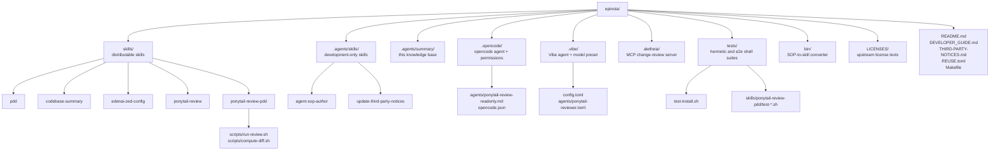

# Codebase Information

<!-- tags: overview, metadata -->

## Identity

- **Name**: epinoia
- **Purpose**: Internal development tools for demiourgoi. Ships reusable agent skills and agent configurations, orchestrates read-only reviews of Prompt-Driven Development (PDD) artifacts, and includes **aletheia**, a Python MCP server that gives terminal coding agents Zed-style asynchronous change review.
- **Kind**: A collection of Markdown skills, shell scripts, and agent/config files, plus one installable Python package (`aletheia/`) with a bundled React web GUI. The skills and scripts have no application binary or service; aletheia runs as an MCP stdio server with a loopback review web server.
- **License**: Original content is MIT. Bundled third-party content keeps its upstream license (Apache-2.0, MIT, or CC-BY-4.0). See `THIRD-PARTY-NOTICES.md` and `REUSE.toml`.

## Technology stack

| Area | Technology |
| --- | --- |
| Executable logic | Bash (bash 4+), `set -euo pipefail` in scripts; aletheia logic in Python |
| Skill format | Agent Skills: a directory with `SKILL.md` (YAML frontmatter + SOP body) and optional `scripts/`, `references/`, `assets/` |
| opencode | Markdown agent definitions with YAML frontmatter; JSON configuration (`opencode.json`) |
| Mistral Vibe | TOML model configuration (`config.toml`) and agent definitions (`agents/*.toml`) |
| aletheia runtime | Python 3.14 (pinned), `uv`/`uvx`, FastMCP (stdio), an in-process loopback HTTP review server |
| aletheia GUI | Vite + React + TypeScript, CodeMirror 6 merge view, bundled as `aletheia/webui/dist` |
| Task automation | `Makefile` targets: `install`, `test`, `test-e2e`, `help`; aletheia: `install`, `webui`, `check`, `test` |
| Compliance | REUSE Specification (`REUSE.toml`, `LICENSES/`) validated with `uvx reuse lint` |
| Auxiliary tooling | `uvx` (`reuse`, `strands-agents-sops`, `skills-ref`), `git`, `opencode` |
| Documentation | Markdown, rendered by the consuming agent/editor; Mermaid for diagrams |

The skills trees contain no Python; aletheia is a separate Python package with its own `pyproject.toml` and `uv.lock` under `aletheia/`. `python3`, `realpath`, and `uuidgen` are optional helpers used by scripts when present.

## Directory map

## Two skill trees

| Tree | Audience | Contents |
| --- | --- | --- |
| `skills/` | Distributable artifacts copied into target projects by `make install` | `pdd`, `codebase-summary`, `edenai-zed-config`, `ponytail-review`, `ponytail-review-pdd` |
| `.agents/skills/` | Development of this repository only | `agent-sop-author`, `update-third-party-notices` |

`make install` copies `skills/`; it never installs `.agents/skills/`.

## aletheia (subproject)

`aletheia/` is an installable MCP server (`uvx --from aletheia aletheia`) that gives terminal coding agents **asynchronous change review**: an agent records a per-conversation baseline, edits or creates files through the baseline-aware `edit` tool (or plain shell edits plus `record_baseline`), and the user reviews live diffs in a loopback web GUI, approving (adopt) or rejecting (rollback on disk). Source layout: `aletheia/src/aletheia_mcp/` (server, review core, web), `aletheia/webui/` (React GUI), `aletheia/tests/` (pytest, unit + an in-memory end-to-end test), `aletheia/.agents/planning/aletheia/` (PDD artifacts from its development). Start from `aletheia/README.md`; never edit the generated `aletheia/webui/dist/assets`.

## Entry points

| Entry point | Role |
| --- | --- |
| `Makefile` | `install`, `test`, `test-e2e`, `help` |
| `tests/run.sh` | Discovers and runs `test-*.sh` suites; gates e2e suites behind `--e2e` |
| `skills/ponytail-review-pdd/scripts/run-review.sh` | Validates parameters and launches a PDD review with opencode |
| `skills/ponytail-review-pdd/scripts/compute-diff.sh` | Computes the diff under review |
| `bin/agent-sop-to-skill.sh` | Converts legacy `*.sop.md` sources into a skill directory |
| `aletheia/src/aletheia_mcp/main.py` | `aletheia` CLI: stdio MCP server (console script and `__main__`) |
| `aletheia/src/aletheia_mcp/setup.py` | `aletheia setup`: installs the baseline-reminder Vibe hook |
| `aletheia/Makefile` | aletheia subproject: `install`, `webui`, `check`, `test` |
| `.agents/skills/agent-sop-author/validate-skill.sh` | Validates a skill against the Agent Skills specification |
| `.opencode/opencode.json` | Declares the reviewer agent's read-only permissions |
| `.vibe/config.toml` | Declares the Vibe `reviewer` model alias and limits |

## Repository state

- `AGENTS.md`: agent-oriented entry point generated from this knowledge base.
- `.agents/summary/`: this knowledge base; keep it in sync when architecture or conventions change.
- `.local/`: gitignored scratch workspace where test suites build fixture repositories.
