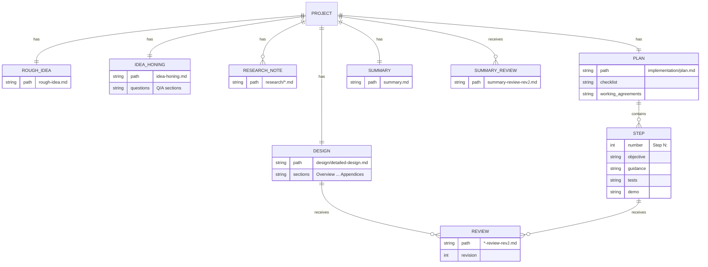

# Data Models

<!-- tags: data-models, schemas, file-formats -->

Epinoia has no application data store. Its "data models" are the file formats that agents and scripts exchange: skill frontmatter, agent configuration, PDD artifacts, review outputs, and compliance metadata.

## Skill definition (`SKILL.md`)

| Field | Required | Constraints |
| --- | --- | --- |
| `name` | Yes | Kebab-case; matches the directory name; at most 64 characters |
| `description` | Yes | At most 1024 characters; states what the skill does and when to use it |
| `license` | No | SPDX identifier or reference to a bundled license file |
| `compatibility` | No | Environment requirements, at most 500 characters |
| `metadata` | No | String map (for example `version`, `tags`) |
| `allowed-tools` | No | Space-separated pre-approved tools (experimental) |

Required body structure: title, `## Overview`, `## Parameters` (with "Constraints for parameter acquisition"), `## Steps` with numbered `### N.` sections and `**Constraints:**` blocks, and recommended `## Examples` and `## Troubleshooting`. RFC 2119 keywords (`MUST`, `SHOULD`, `MAY`) express requirement strength.

## PDD project



## Review artifacts

| Artifact | Path | Producer |
| --- | --- | --- |
| Review report | `design/detailed-design-review-rev{J}.md` | Reviewer agent |
| Review report | `implementation/step-{I}-review-rev{J}.md` | Reviewer agent |
| Review report | `summary-review-rev{J}.md` | Reviewer agent |
| Transcript | Same base as the review, `.log` extension | `run-review.sh` (opencode stdout/stderr) |
| Diff | `{project_dir}/changes-{UUID}.diff` | `compute-diff.sh` |
| Vibe report | `.review.md` in the working directory root | Vibe reviewer agent |

`{J}` is the smallest positive integer for which the review file does not exist. Re-running after fixes therefore produces `rev2`, `rev3`, and so on without overwriting earlier reports.

## opencode agent and permissions

`ponytail-review-readonly.md` frontmatter: `description`, `mode`, `model`. The body is the system prompt and declares the single writable file.

Permissions are an ordered list of entries:

```json
{ "action": "edit|shell|read|glob|grep|webfetch|websearch|external_directory|subagent|execute|question",
  "resource": "<glob or command pattern>",
  "effect": "allow|ask|deny" }
```

## Vibe configuration

Agent file (`.vibe/agents/ponytail-reviewer.toml`): `agent_type`, `display_name`, `description`, `instructions`, `safety`, `enabled_tools`, `active_model`, plus `[tools.bash]` and `[tools.write_file]` blocks with `permission`, `allowlist`, `denylist`, and `outside_workdir`.

Model preset (`.vibe/config.toml`):

| Field | Value in this repository | Meaning |
| --- | --- | --- |
| `name` | `zai-glm-5-3` | Provider model ID |
| `provider` | `mistral` | Built-in Mistral API provider |
| `alias` | `reviewer` | Local alias used by `active_model` |
| `thinking` | `max` | Reasoning level sent to the provider |
| `max_context_length` | `1000000` | Context window used for compaction |
| `auto_compact_threshold` | `800000` | Input-token count that triggers compaction |

## Compliance metadata

`REUSE.toml` contains annotation groups. Each group has:

- `path` — one path or an array of paths;
- `SPDX-FileCopyrightText` — one copyright line or an array;
- `SPDX-License-Identifier` — SPDX identifier.

Groups in this repository: original MIT content, modified ponytail derivative (MIT), verbatim ponytail copy (MIT), modified Strands derivatives (Apache-2.0), and the agentskills specification asset (CC-BY-4.0). `LICENSES/` holds the full texts; `THIRD-PARTY-NOTICES.md` holds human-readable attribution.

## Test harness model

| Symbol | Meaning |
| --- | --- |
| `$OUT_FILE` | Temporary file capturing stdout+stderr of the last `run`/`run_in` call |
| `$RC` | Exit code of the last `run`/`run_in` call |
| `TESTS_RUN`, `TESTS_FAILED` | Counters updated by `ok`/`fail` |
| `WORK_DIR` | Scratch directory under `.local/`; suites create fixtures there and leave them for inspection |
| `finish` | Prints a summary and returns non-zero when any check failed |

Suites signal failure only through `finish`; individual `assert_*` helpers record results and never exit early.
