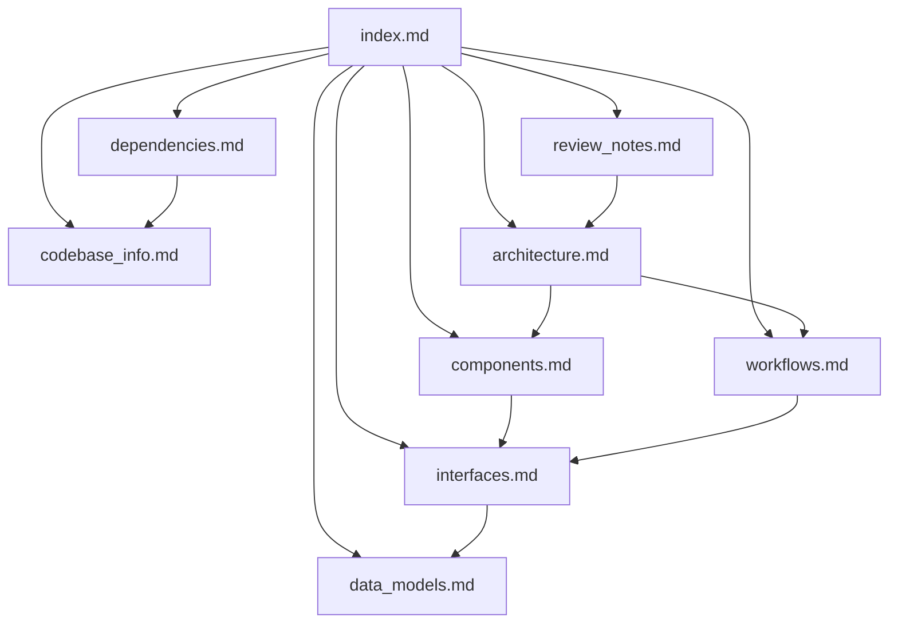

# Knowledge Base Index

<!-- tags: index, routing, metadata -->

This directory is the detailed knowledge base for the `epinoia` repository. It is written for AI assistants and developers who need to understand or change the repository without reading every file.

## How to use this knowledge base

- Start here. Each entry below states what the file covers and when to open it.
- For a quick orientation, read `codebase_info.md`, then `architecture.md`.
- For a change, read the file that owns the affected area and cross-check the relevant interfaces and tests.
- Treat these documents as an index into the code: verify claims against the actual files before editing.
- When architecture, layout, commands, or conventions change, update this directory and `AGENTS.md` in the same change.

## Files

| File | Purpose | Open when |
| --- | --- | --- |
| `codebase_info.md` | Identity, stack, directory map, entry points, repository state | You need orientation or a file-layout overview |
| `architecture.md` | Layers, execution surfaces, design principles, failure containment | You need to understand how the pieces fit or why a decision was made |
| `components.md` | Every component, its responsibility, and its key files | You need to find where a behavior lives |
| `interfaces.md` | CLI flags, exit codes, stdout/stderr contracts, agent/config/file interfaces, environment variables | You are changing a command, config, or agent contract |
| `data_models.md` | Skill frontmatter, PDD artifacts, review artifacts, permissions, Vibe config, compliance metadata, test harness model | You need the exact shape of a file or record |
| `workflows.md` | Install, PDD lifecycle, PDD review, skill authoring, compliance, tests, Vibe review | You need the order of operations or a sequence diagram |
| `dependencies.md` | Required and optional tools, models, uvx tooling, third-party inventory, portability notes | You need to know what must be installed or what a change may break |
| `review_notes.md` | Consistency findings, coverage gaps, recommendations | You need to know what is verified, what is not, and what to improve |

## Relationships

## Question routing

| Question | Read |
| --- | --- |
| What is epinoia, and where is a given file? | `codebase_info.md` |
| Why are opencode files installed at the git root but Vibe files at the target root? | `architecture.md`, `interfaces.md` |
| How does a PDD review run end to end? | `workflows.md` |
| What flags does `run-review.sh` accept, and what does it print? | `interfaces.md` |
| Where is the default review model defined? | `interfaces.md`, `dependencies.md` |
| What does a review file or diff file look like? | `data_models.md` |
| How do I add or validate a skill? | `workflows.md`, `.agents/skills/agent-sop-author/SKILL.md` |
| How do I record third-party content? | `workflows.md`, `.agents/skills/update-third-party-notices/SKILL.md` |
| Which tests cover a change, and what is missing? | `review_notes.md` |
| What external tools or licenses are involved? | `dependencies.md` |

## Example queries this knowledge base answers

- "Which directory is copied by `make install`, and where does each part land?"
- "How is the reviewer prevented from editing files?"
- "How does `run-review.sh` choose the review revision number?"
- "What happens when `code-uncommitted` has no changes?"
- "Which file is the source of truth for the review model?"
- "Which files must be updated when third-party content is added?"
- "Which test suites run by default, and which spend model tokens?"
