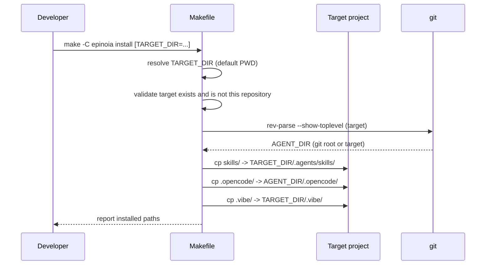
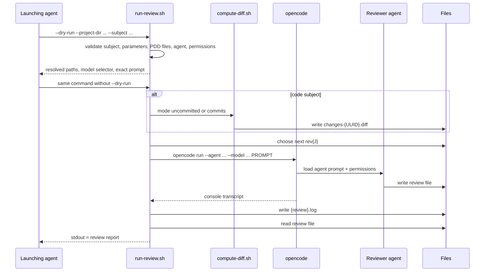
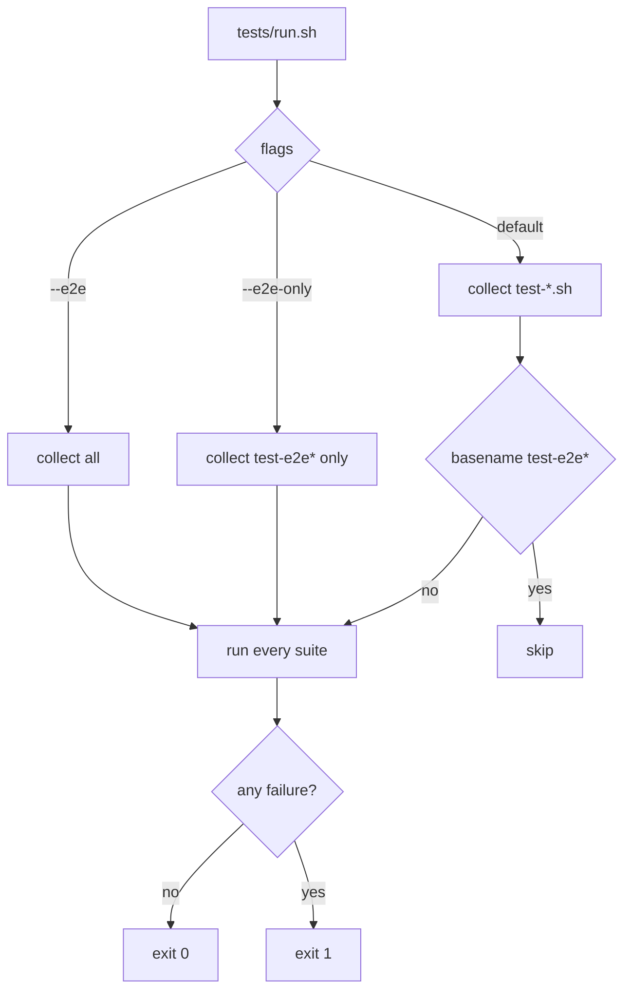

# Workflows

<!-- tags: workflows, processes -->

## 1. Install skills and agent configuration

Guards: an empty or missing `TARGET_DIR` exits 2; a target that resolves to this repository exits 2. Existing files are overwritten; unrelated files are untouched.

## 2. Prompt-Driven Development (PDD)

The `pdd` skill drives an interactive, gated process. It never advances without explicit user confirmation.

1. Create the project directory and the PDD file layout.
2. Choose whether to start with requirements clarification or research.
3. Refine requirements one question at a time, recording each question and answer in `idea-honing.md`.
4. Research topics into separate files under `research/`, including Mermaid diagrams and sources.
5. Checkpoint: continue clarifying, continue researching, or proceed to design.
6. Write a self-contained `design/detailed-design.md` (Overview, Requirements, Architecture, Components/Interfaces, Data Models, Error Handling, Testing Strategy, Appendices).
7. Write `implementation/plan.md` with a checklist, a fixed "Working agreements" section, and numbered steps that each state objective, guidance, tests, integration, and a demo.
8. Write `summary.md` and present the result.

## 3. Review a PDD artifact

Rules the launching agent must follow:

- Always run `--dry-run` first and show the resolved review file path.
- Do not modify the generated prompt; it is the reviewed contract with the reviewer agent.
- Do not add `--auto`, `--thinking`, or verbosity flags.
- Allow at least 10 minutes for the real run.
- Present the report in full; do not apply fixes unless explicitly asked.

## 4. Author and validate a skill

1. Use `.agents/skills/agent-sop-author/SKILL.md` to design parameters, steps, constraints, examples, and troubleshooting.
2. Put deterministic logic in `scripts/`; keep `SKILL.md` concise (under 500 lines).
3. Create the skill under `skills/` if it is distributable, or under `.agents/skills/` if it is development-only.
4. Run `.agents/skills/agent-sop-author/validate-skill.sh <skill-dir>` after every change and fix all errors.
5. If the skill is a third-party derivative, run the compliance workflow below.

## 5. Record third-party content

1. Verify the upstream license and copyright from the upstream repository; stop on copyleft.
2. Ensure `LICENSES/<SPDX-ID>.txt` exists with the full text.
3. Verbatim copy: keep files byte-identical, add a `LICENSE` sidecar, and add no headers.
4. Modified derivative: keep the upstream license, add a `LICENSE` sidecar stating the changes, and set the `license` frontmatter field for skills.
5. Update `THIRD-PARTY-NOTICES.md` (project URL, copyright, license, status, per-file table, verbatim NOTICE quote).
6. Add or update the matching `REUSE.toml` annotation group.
7. Run `uvx reuse lint` until it reports full compliance.

## 6. Run the tests

Hermetic suites must not touch the network, spend tokens, or write outside `.local/`. Live suites run real opencode sessions and are gated behind `--e2e`.

## 7. Review with Mistral Vibe (alternative surface)

1. Install with `make install` so `.vibe/` lands in the project.
2. Start Vibe with the `ponytail-reviewer` agent.
3. The agent loads the `ponytail-review` skill, reads the artifact, and writes `.review.md`.
4. Read-only enforcement comes from the agent instructions plus `[tools.bash]`/`[tools.write_file]` permissions.

The Vibe path is independent of `run-review.sh` and does not produce revision-numbered review files or a `.log` transcript; it is a manual alternative to the opencode orchestration.
