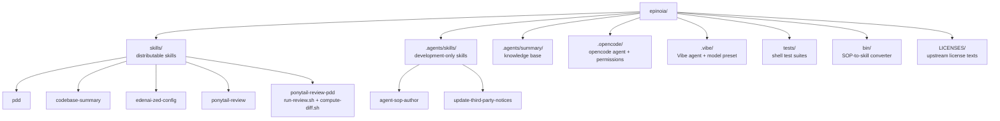

# epinoia — AGENTS.md

<!-- auto-generated by codebase-summary; full knowledge base in .agents/summary/index.md -->

This file is the agent-oriented entry point to the repository. It covers navigation, entry points, and repo-specific conventions. If the answer to a question is not on this page — full workflows, file formats, interface details — open [`.agents/summary/index.md`](.agents/summary/index.md) first; it routes to the detailed knowledge base files. The **Custom Instructions** section at the end is human-maintained and authoritative for project context and conventions.

## Table of Contents

- [Knowledge base](#knowledge-base) — where to go when this page doesn't have the answer
- [Codebase at a glance](#codebase-at-a-glance) — what this repo is and how its pieces fit
- [Directory organization](#directory-organization) — where skills, agents, tests, and configs live
- [Key entry points](#key-entry-points) — how work starts
- [Repo-specific conventions and gotchas](#repo-specific-conventions-and-gotchas) — behavior-changing details agents must know
- [Repo-specific commands](#repo-specific-commands) — the Makefile-driven workflow
- [Custom Instructions](#custom-instructions) — human-maintained project context (preserved across refreshes)

## Knowledge base

<!-- tags: knowledge-base, routing -->

If this page doesn't answer your question, open [`.agents/summary/index.md`](.agents/summary/index.md) — it is the routing table for everything else.

## Codebase at a glance

<!-- tags: overview, stack -->

- **What**: `epinoia` is demiourgoi's internal development toolkit. It ships reusable **agent skills** and **agent configurations** for opencode and Mistral Vibe, and orchestrates read-only reviews of Prompt-Driven Development (PDD) artifacts. There is no application binary, package build, or runtime service.
- **Two skill trees**: `skills/` holds distributable artifacts copied into target projects by `make install`; `.agents/skills/` holds development-only skills that are never installed elsewhere.
- **Stack**: Bash for all executable logic, Markdown for skills/agents/docs, JSON for opencode permissions, TOML for Vibe configuration, `Makefile` for tasks, `uvx` for compliance and skill validation. No Python/Node application code and no lockfile.
- **License/compliance**: original content is MIT; bundled third-party content keeps upstream licenses and is tracked in `THIRD-PARTY-NOTICES.md`, `REUSE.toml`, and per-directory `LICENSE` sidecars.

See: [`.agents/summary/codebase_info.md`](.agents/summary/codebase_info.md), [`.agents/summary/dependencies.md`](.agents/summary/dependencies.md).

## Directory organization

<!-- tags: navigation, layout -->

- New distributable skills go in `skills/<name>/` with a `SKILL.md` whose frontmatter `name` matches the directory.
- New development-only skills go in `.agents/skills/<name>/`.
- Deterministic logic belongs in `scripts/`, not in prose.
- New tests go in `tests/`; a suite is any `test-*.sh` file and is discovered automatically.

See: [`.agents/summary/components.md`](.agents/summary/components.md).

## Key entry points

<!-- tags: entry-points -->

- **`Makefile`** — `install` copies artifacts into a target project; `test` runs hermetic suites; `test-e2e` adds live opencode smoke tests.
- **`skills/ponytail-review-pdd/scripts/run-review.sh`** — validates a review request, computes code diffs, picks the next `rev{J}`, builds the prompt, and runs `opencode run --agent ponytail-review-readonly`.
- **`skills/ponytail-review-pdd/scripts/compute-diff.sh`** — builds `uncommitted` or `commits` diffs and excludes review artifacts.
- **`.opencode/agents/ponytail-review-readonly.md`** — the reviewer prompt; its frontmatter `model:` line is the single source of truth for the default review model.
- **`.opencode/opencode.json`** — read-only permissions for that agent.
- **`.vibe/agents/ponytail-reviewer.toml`** — the Vibe reviewer; references `active_model = "reviewer"`.
- **`.vibe/config.toml`** — the Vibe `reviewer` model preset (`zai-glm-5-3`, `thinking = "max"`, 1M context).
- **`.agents/skills/agent-sop-author/validate-skill.sh`** — validates a skill against the Agent Skills specification.
- **`tests/run.sh`** — suite runner with `--e2e` and `--e2e-only` modes.

See: [`.agents/summary/interfaces.md`](.agents/summary/interfaces.md).

## Repo-specific conventions and gotchas

<!-- tags: conventions, gotchas -->

1. **Install placement follows discovery rules.** `make install` copies `skills/` to `TARGET_DIR/.agents/skills/` (Zed), `.opencode/` to the **git root** of `TARGET_DIR` (opencode searches upward from its working directory, and reviews run at the repository root), and `.vibe/` to `TARGET_DIR` (Vibe loads the closest `.vibe/` walking up). Installing opencode files inside a subdirectory of a repository makes them invisible to the reviewer.
2. **The reviewer is read-only by construction.** `.opencode/opencode.json` denies edits and shell except an allowlist of read-only git commands, and allows writing only `*-review-rev*.md`. The agent prompt repeats the restriction. Never add `--auto` to the opencode invocation; it weakens permission enforcement.
3. **The default review model lives in the agent, not the script.** `run-review.sh` parses the `model:` line from `.opencode/agents/ponytail-review-readonly.md`; tests rewrite that line to prove nothing is hardcoded. Change the model there, not in the script.
4. **`run-review.sh` has a strict stdout/stderr contract.** On a real run, stdout is only the review report; paths, heartbeats, and errors go to stderr, and the full opencode transcript goes to `{review}.log`. The launching agent must present the report in full and must not modify the generated prompt.
5. **Revision files never overwrite.** The next review is the first free `rev{J}` (`rev1`, `rev2`, …). Re-running after fixes is expected; do not delete earlier reviews to force `rev1`.
6. **Vibe uses an alias.** `.vibe/agents/ponytail-reviewer.toml` sets `active_model = "reviewer"`, resolved by the `[[models]]` entry in `.vibe/config.toml`. Renaming the alias requires updating the agent.
7. **Tests are hermetic by default.** `make test` runs only `test-*.sh` suites that do not touch the network. Suites named `test-e2e*` spend model tokens, need opencode authentication, and run only with `--e2e`. Fixtures live under gitignored `.local/` and are kept for inspection.
8. **Skill authoring is validated, not improvised.** Use `.agents/skills/agent-sop-author/`; keep `SKILL.md` under 500 lines and move detail to `scripts/` or references. Run `validate-skill.sh` after every change and fix all errors.
9. **Compliance is part of every change.** Third-party content requires a `LICENSE` sidecar (verbatim copies stay byte-identical), a `THIRD-PARTY-NOTICES.md` entry, and a `REUSE.toml` annotation. Original new files also need REUSE annotations. Finish with `uvx reuse lint`.
10. **Model/limits values in the Vibe config are deliberate.** `zai-glm-5-3` has a 1M-token context window; `auto_compact_threshold = 800000` leaves room for its 128k maximum output. Do not lower them without checking the provider's documented limits.
11. **Opencode's local version may lack a `grep` tool.** The Vibe agent comments note that Vibe 3.1.0 does not expose one; shell allow/deny lists and built-in `read_file` are used instead.

## Repo-specific commands

<!-- tags: commands -->

| Command | Purpose |
| --- | --- |
| `make test` | Run every hermetic suite (default; no network, no model calls) |
| `make test-e2e` | Run hermetic suites plus live opencode smoke tests (spends tokens) |
| `tests/run.sh --e2e-only` | Run only the live opencode smoke tests |
| `make -C /path/to/epinoia install` | Install skills and agent configs into the current project |
| `make -C /path/to/epinoia install TARGET_DIR=/path/to/project` | Install into an explicit target |
| `.agents/skills/agent-sop-author/validate-skill.sh skills/<name>` | Validate a skill |
| `uvx reuse lint` | Run the license/compliance gate |
| `bin/agent-sop-to-skill.sh <skill-name>` | Convert legacy `*.sop.md` sources into a skill |

The Vibe model preset is validated by the Vibe CLI itself at startup; `vibe config schema` prints the local schema if a check is needed.

## Custom Instructions

<!-- This section is maintained by developers and agents during day-to-day work.
     It is NOT auto-generated by codebase-summary and MUST be preserved during refreshes.
     Add project-specific conventions, gotchas, and workflow requirements here. -->
