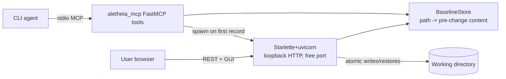

# Detailed design: Aletheia — revision 2 (baseline-only review)

Revision 1 (superseded, kept as `detailed-design.md`) introduced change
**sessions** with per-file decided statuses. Revision 2 removes the session
concept after author review of the first implementation: the review model
aligns with Zed, which anchors a per-turn baseline, allows one review in
flight, and treats keep/reject as actions, not states. This document is a
standalone, complete restatement for reviewers; only the deltas vs revision
1 need its history (see the idea-honing Q12–Q15 rationale).

## Overview

Aletheia is an MCP server that gives terminal coding agents (such as
Mistral Vibe CLI) a Zed-style asynchronous change review:

1. Before editing, the agent calls **`record_baseline(paths)`**: the
   server snapshots the current content of those files (missing paths are
   marked as to-be-created) and returns the **constant review URL** — at
   this moment it starts a loopback web server on an **autodetected free
   port**.
2. The agent edits files normally; changes are on disk, linters and tests
   run against them.
3. The user can open the URL at any time: a live, side-by-side,
   syntax-highlighted diff of every baseline file against the **current
   working directory**. They can edit the proposed content (writes go to
   the working directory atomically), **approve** (adopt the working
   directory for chosen files — or everything), or **reject** (restore
   pre-change content on disk — or everywhere).
4. The agent can also drive decisions through **mirrored MCP tools**
   (`remove_from_baseline`, `rollback_to_baseline`) and poll
   **`get_change_status()`** to see the live drift.

Decisions shrink the baseline: **an entry exists only while its file is
under review.** Approve drops the entry; reject restores disk content and
then drops it. A file not in the baseline is not under review, and a new
change round starts when the agent records the baseline again.



## Detailed requirements

- **R1 — Baseline model.** One baseline per MCP process (one agent
  conversation): absolute path → content snapshot (`str`) or
  to-be-created marker (`None`). Recording a path overwrites its entry
  (reset for a new round). Only UTF-8 text files (directories and
  non-UTF-8 files are rejected with errors naming the path).
- **R2 — Constant URL, free port.** The web server binds `ALETHEIA_HOST`
  (default `127.0.0.1`) and an OS-assigned free port (bind to port 0) on
  the first `record_baseline`; `ensure_running` is idempotent for the
  process lifetime and the resulting URL is returned by every baseline-
  touching tool result so the agent can show it to the user. There is no
  port setting. The URL path is `/`; no session ids are encoded anywhere.
- **R3 — Live diff.** Status and GUI payloads are computed on demand:
  baseline vs current working directory (missing on disk = deleted;
  creation-marker with missing file = still-undesired creation).
- **R4 — Operations (per set of paths; REST + mirrored MCP tools).**
  - `add` (`record_baseline`): snapshot now.
  - `remove` (approve): drop entries for the paths; the working directory
    becomes the truth. Approve-all is `remove` over all entries.
  - `rollback` (reject): atomically restore baseline content to disk;
    a to-be-created marker whose file exists is deleted; the entry is
    dropped after the disk effect succeeds.
  - Operations on paths without baseline entries fail with an actionable
    `NotInBaselineError` (HTTP 404 / tool error).
- **R5 — GUI review.** Same CodeMirror 6 merge view as revision 1
  (side-by-side, editable right pane, filename-based syntax highlighting).
  Per-file buttons: **Approve** (remove), **Reject** (rollback), **Save
  edit** (write the edited right-pane content to the working directory,
  atomic; entry stays). Global: **Approve all**, **Reject all**
  (over all entries), **Refresh**. After any action the view refetches
  the live payload; an empty baseline shows "nothing under review".
- **R6 — Status.** `get_change_status()` returns the URL, the number of
  baseline files, and per file: path, kind (`created` / `deleted` /
  `modified`), and `changed` (content differs between baseline and disk).
  It is cheap by construction: one file read per baseline file, no
  unified-diff computation and no file contents in the payload (full
  contents and diffs are only computed for the GUI payload, R5). All
  results are derived state; there is no decided-status machine, no
  409 semantics, no session store, and no caps beyond the conversation.
- **R7 — Concurrency.** Tool thread and web thread share the baseline
  store under one lock; disk effects execute inside it (state follows
  disk).
- **R8 — Vibe hook (v1, best-effort).** `aletheia setup` installs a
  `post_tool` hook (`.vibe/hooks.toml` + `.vibe/hooks/aletheia_baseline.py`)
  matching `re:edit|write_file`, reading the edited path from the payload
  (extraction rule: `file_path` then `path` then `filename`; otherwise the
  hook exits silently — with `strict=false` a malformed payload is a
  warning, never a denial) and appending `additional_context` reminding
  the agent to `record_baseline` paths not recorded. Installation is idempotent (hook
  name `aletheia-baseline`), merge-safe with existing hooks. MCP server
  and tool descriptions instruct baseline-before-edit. No shared state, no
  enforcement (deferred).
- **R9 — Package.** Unchanged from revision 1: Python 3.14 pinned,
  FastMCP (stdio), console command `aletheia` (cyclopts app with the
  default `run` command and `setup`), hatchling `src/aletheia_mcp`
  packaging with the committed GUI build, uvx-compatible, same author.

Out of scope (documented): hunk-level accept/reject, git integration,
persistence across restarts (the baseline dies with the process, like
Zed's per-thread review state), enforcement of baseline recording, binary
files.

## Architecture Overview

Same three layers; the **session layer is deleted**:

- **MCP tools** (`server/tools/review_tools.py`): `record_baseline(paths)`,
  `get_change_status()`, `remove_from_baseline(paths)`,
  `rollback_to_baseline(paths)`; JSON string results; docstrings as agent
  manual (including the baseline-before-edit protocol).
- **Review core** (`review/`): `BaselineStore` (+`remove`, `entries`,
  `paths`), `diffs.py` (unified diffs with created/deleted markers),
  `disk.py` (atomic writes, deletion), and `ReviewService` orchestrating
  live diffs and the four operations. `sessions.py` is removed; errors:
  `UnsupportedFileError`, `NotInBaselineError`, `InvalidDecisionError`
  (empty path lists), `DiskEffectError`, `ServerStartError`.
- **Web layer** (`web/app.py`, `web/server.py`, `webui/`): Starlette app
  (`/api/review` GET; `POST /api/baseline/files` add; `DELETE
  /api/baseline/files` remove; `POST /api/rollback` rollback; `POST
  /api/content` save edit; `/` GUI) and the Vite/React/TypeScript client.
  The uvicorn thread binds port 0 and reports the real port for URL
  building (same startup contract as revision 1: wait until accepting,
  fast failure on bind errors).

```mermaid
sequenceDiagram
    participant A as Agent (MCP)
    participant U as User (browser)
    A->>M: record_baseline(paths)
    M-->>A: URL + recorded paths
    A->>A: edits files on disk, linters run
    U->>S: opens constant URL
    S-->>U: live diffs per baseline file
    U->>S: Save edit (writes disk) / Approve (remove) / Reject (rollback)
    A->>M: get_change_status()
    M-->>A: live drift; rejected files restored, out of review
```

## Components and Interfaces

```
BaselineStore: record(paths) -> dict[Path, Baseline]
              remove(paths) -> None (NotInBaselineError on missing)
              get(path) -> Baseline (NotInBaselineError on missing)
              paths() -> sorted list[Path]
ReviewService: record_baseline(paths) -> dict (incl. url)
               remove_from_baseline(paths) -> dict
               rollback_to_baseline(paths) -> dict
               get_change_status() -> dict
               review_payload() -> dict (contents + live statuses, for GUI)
web/app.py:    create_app() with the R5 endpoints
web/server.py: ensure_running(settings) -> str URL (free port, binds once)
setup.py:      install_hook(directory) -> Path (writes hooks.toml + script)
```

## Data Models

```
Baseline { content: str | None }            # None == to-be-created marker
FileView { path, kind: created|deleted|modified, changed: bool,
           baseline: str|None, current: str|None }
Review payload: { url, files: [FileView + diff] }
```

## Error Handling

`UnknownBaselineError`/`UnknownSessionError`/`AlreadyDecidedError` are
replaced by `NotInBaselineError` ("path is not in the baseline; call
record_baseline first"). HTTP mapping: 404 for `NotInBaselineError`, 400
for `InvalidDecisionError`/payload shape errors, 500 for disk/server
errors (wrapped in `DiskEffectError` with file + action context).
Rollback drops the entry only after the restore succeeded. Save-edit
failures are wrapped the same way (`DiskEffectError` naming the file and
the action, mapped 500 in the REST layer with an actionable message).

## Testing Strategy

Unit: store record/remove/markers; live diff kinds and `changed`;
rollback restores then removes (creation markers delete files), failures
leave entries; remove semantics; service JSON shapes; free-port server
lifecycle (URL contains the real port; second ensure_running is
idempotent). Tools over the fastmcp in-memory client: full agent loop incl.
drift polling and mirrored decisions. REST via Starlette TestClient incl.
404/400. Hook installer: merge into an existing hooks.toml, idempotency,
script content. E2E against the real uvicorn thread on an ephemeral port:
record → edit → GUI payload → save edit → approve (keep working dir) →
reject (restored, out of baseline). `make check` + `make webui` unchanged.

## Appendices

- **Dropped from revision 1** (author-sanctioned): sessions, session id
  hash, decided statuses, 409 semantics, `ALETHEIA_PORT` and
  `ALETHEIA_MAX_SESSIONS`, `open_review`/`get_review_status`.
- **Mounting alternative (Q12)**: rejected because an HTTP-mounted MCP
  server requires a pre-known URL in client config, moving launch/lifecycle
  to the user and conflicting with port autodetection; stdio + free-port
  GUI achieves the goal (no port configuration) without transport changes.
- **Zed research**: per-turn baseline ("the file as it was right before
  the agent's turn"), one review in flight per thread, keep/reject as
  actions, review state transient — all confirmed on the Zed agent panel
  docs and the ACP review-bridge implementation notes.
