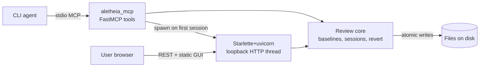
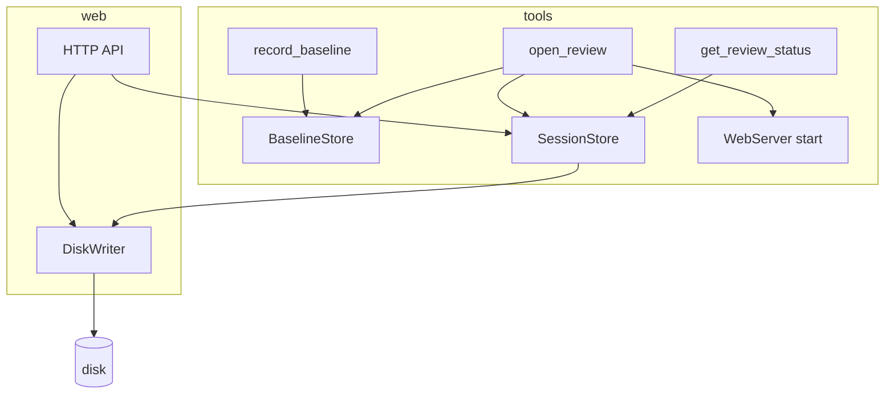

# Detailed design: Aletheia

## Overview

Aletheia is an MCP server that gives terminal coding agents (such as Mistral
Vibe CLI) a **Zed-style asynchronous change review**:

1. Before editing, the agent records a **baseline** of the files it will touch.
2. The agent edits files normally; changes are on disk, so linters and tests
   run against them.
3. The agent calls `open_review`; the server computes the diffs against the
   baseline, lazily starts a loopback web server, and returns a **review URL**
   with a deterministic session id (hash of the diff). The call does not
   block; the agent keeps working and shares the URL with the user.
4. The user opens the URL: a side-by-side, syntax-highlighted diff editor per
   file. They can **approve**, **edit then approve**, or **reject** each file,
   or act on the whole set. Approvals keep the disk state; edits are written
   to disk immediately; **rejections roll the file back to its baseline
   content on disk immediately** (created files are deleted).
5. The agent can poll `get_review_status` to see decisions and reverts.



The MCP layer is stateless tool logic; the process-local review core and the
web app keep **ephemeral in-memory state** (baselines and sessions, lost on
process exit by design).

## Detailed requirements

Consolidated from requirements clarification:

- **R1 Baseline capture.** A tool records the pre-edit content of a list of
  files (UTF-8 text, error otherwise; directories rejected with an error).
  A path that does not exist yet is recorded as a to-be-created marker, so
  file creation is reviewable and revertible (deletion on reject).
  Re-recording a path overwrites its baseline.
- **R2 Non-blocking open.** `open_review(paths)` requires every path to have
  a baseline (clear error naming the missing path, pointing at
  `record_baseline`). It computes per-file unified diffs (vs baseline),
  creates an in-memory session, and returns `session_id` + `url` + per-file
  summary. Files with no textual change are included (status trivially
  decided by the user) — simpler and honest: the review set is explicit.
- **R3 Deterministic ids.** Session id = first 12 hex chars of SHA-256 of a
  canonical form of the diff set (sorted absolute paths + unified diff text).
  Re-opening the identical set returns the same session. A collision with
  different content disambiguates with a `-2`, `-3`, … suffix.
- **R4 GUI review.** Loopback HTTP server (port `ALETHEIA_PORT`, default
  8417; host `ALETHEIA_HOST`, default `127.0.0.1`), started lazily on first
  `open_review` via an idempotent `ensure_started` on a single server
  instance; start blocks on a startup event so the returned URL is accepting
  connections, and a bind failure surfaces as `ServerStartError` (never a
  stale success). URL shape:
  `http://127.0.0.1:PORT/s/{session_id}`. The GUI shows per-file
  side-by-side editable diffs with syntax highlighting for popular languages
  (Java, Python, JavaScript/TypeScript, C/C++, Go, Rust, …), file-level
  Approve / Reject buttons, an "approve all" / "reject all" control, and
  session status.
- **R5 On-disk effects (immediate, atomic).** The only *decided* states are
  `approved` and `rejected`; `edited` is a pending state (the user has saved
  modified content but has not approved it yet):
  - approve: no disk write; file state `approved`.
  - save_edit: allowed while the file is `pending` or `edited` (iterative
    tweaking); the user's edited content is written atomically (temp file +
    `os.replace` in the same directory); state `edited`. Allowed also for a
    file that was absent at open time (the parent directory existed when the
    file was created). Server never creates directories; a failed parent
    raises an error.
  - reject: baseline content is written back atomically; a file whose
    baseline is the created-marker (which was unchanged or deleted since) is
    deleted; state `rejected`.
  - approve/reject (and the `_all` variants acting only on undecided files)
    accept files in `pending|edited`; acting on a decided file is rejected
    with 409. Saving an edit on a decided file is a 409.
- **R6 Status tool.** `get_review_status(session_id)` returns the overall
  state plus per-file state and per-file "was reverted on disk" info. Overall
  state: `pending` while any file is `pending`/`edited`; once every file is
  decided, `all_approved`, `all_rejected`, or `mixed` (all decided, decisions
  differ). Unknown session id errors.
- **R7 Lifetime.** Baselines live until process exit. The session store
  holds at most `ALETHEIA_MAX_SESSIONS` (default 100; oldest dropped —
  `shortcut:` documented).
- **R8 Package.** Python 3.14 (`>=3.14,<3.15`), FastMCP, stdio transport,
  console command `aletheia` (cyclopts app), hatchling packaging of
  `src/aletheia_mcp`, wheel bundles the built web GUI; `uvx` compatible;
  author matches Harold (`Juan Rodriguez <juanrh@pm.me>`).
- **R9 Quality bar.** ruff + format clean, mypy strict, pytest suite
  covering baseline capture, diff/id computation, session store lifecycle,
  revert/edit disk effects, HTTP API, and MCP tool wiring.

Out of scope (documented): hunk-level accept/reject, git integration,
multi-user/auth, persistence across restarts, binary files.

## Architecture Overview

Three layers, all in-process:

- **MCP tool layer** (`server/tools/*`): thin, typed wrappers that validate
  input, delegate to the core, and shape tool results for an LLM caller
  (docstrings written as agent guidance).
- **Review core** (`review/`): pure logic plus disk I/O helpers. Tool-thread
  and web-thread share the stores, so a single `threading.Lock` per store
  guards every method; disk effects execute inside the lock so "state follows
  disk" is atomic per decision (single-user scale makes one lock ample):
  - `BaselineStore`: absolute path → `Baseline(content: str | None)` where
    `None` is the to-be-created marker.
  - `SessionStore`: session id → `ReviewSession`.
  - `ReviewSession`: files (sorted by path), each a `FileReview` with
    baseline snapshot, content-at-open, mutable status, and a `decide()`
    applied through `DiskWriter`.
  - `DiskWriter`: single place for atomic text writes / deletions.
- **Web layer** (`web/` + `webui/`): Starlette app with a JSON API and
  static serving of the React build; and the Vite/React/TypeScript client.



Data flow for a decision: browser → `POST /api/sessions/{id}` → core
`decide()` → `DiskWriter` atomic effect → updated session state → next
`get_review_status` poll.

## Components and Interfaces

### Settings (`settings.py`)

pydantic-settings, prefix `ALETHEIA_`: `port: int = 8417`,
`host: str = "127.0.0.1"`, `max_sessions: int = 100` (gt 0). Process-wide
singleton, env-read once at import.

### MCP tools

```
record_baseline(paths: list[str]) -> str
    Record pre-edit content for each path (must exist or be a planned
    creation). Returns human-readable confirmation listing recorded /
    newly-marked paths.

open_review(paths: list[str]) -> str
    Returns a JSON string: {"session_id", "url", "status": "pending",
    "files": [{"path", "status": "pending"}]} for the agent/LLM.

get_review_status(session_id: str) -> str
    Returns JSON: {"session_id", "status", "files":
    [{"path", "status", "reverted": bool, "edited": bool}]}.
```

Paths are resolved against the process working directory; absolute paths
accepted. Validation errors raise tool-visible exceptions with actionable
messages (the FastMCP default error propagation is used, mirroring Harold).

### Review core

```
Baseline record(path) -> Baseline   # reads, validates UTF-8 text, stores
BaselineStore.get(path) -> Baseline | KeyError
SessionStore.create(files, diffs) -> ReviewSession  # id + collision suffix
SessionStore.get(id) -> ReviewSession | KeyError
ReviewSession.decide(path_id, action) -> FileReview
    action ∈ {"approve", "reject", "save_edit"} (save_edit carries content)
ReviewSession.status() -> Literal["pending", "all_approved", "all_rejected", "mixed"]
```

Sessions expose files in a stable, sorted order with positional `file_id`s
(integers as strings in URLs) because paths aren't URL-safe; file identity in
API actions is positional within the immutable per-session file list.

### HTTP API (loopback only)

```
GET  /api/sessions/{id}            -> session JSON (contents included)
POST /api/sessions/{id}/files/{n}/decision
     body {"action": "approve"|"reject"|"save_edit", "content": str?}
     -> updated file review JSON; 409 on decided file, 400 on invalid action
POST /api/sessions/{id}/decision
     body {"action": "approve_all"|"reject_all"}
GET/  /s/{id}                       -> SPA route (index.html)
static /assets/*                     -> built GUI
```

### Web GUI

Vite + React + TypeScript; components: `SessionPage` (file list + statuses +
global actions) and `DiffPane` (`@uiw/react-codemirror` with
`@codemirror/merge` `MergeView`, language from
`@codemirror/language-data` `LanguageDescription` by filename). The right
pane is editable; "Save edit" posts `save_edit`; reads refresh from GET.
No framework state library; `fetch` + `useState`/`useEffect`.

## Data Models

```
Baseline = {content: str | None}         # None == to-be-created marker
FileReview = {
    path: str,                # absolute, display uses it as label
    baseline: Baseline,
    current_at_open: str | None,   # None == file absent at open time
    status: Literal["pending", "approved", "edited", "rejected"],
}
ReviewSession = {id: str, files: list[FileReview], created_at: datetime}
Session id: sha256(canonical_diff_text)[:12], canonical = "\n".join over
    sorted files of (abs_path + "\0" + unified_diff(baseline_text, current_text))
    where a created-marker baseline serializes as the literal marker line
    "<created>" and an absent file at open time as "<deleted>" (stable across
    platforms). Overall status: pending while any file is pending/edited,
    else all_approved / all_rejected / mixed
```

Statuses are mutually exclusive per file; `edited` means saved-but-still-pending
user modifications (`approved` after an edit keeps the saved content; `reject`
discards it by reverting the baseline); `reverted` is derived
(`status == "rejected"`). The session reviews the content snapshot at open
time; the agent may keep editing files during the review, but the GUI reviews
that snapshot (out of scope: live diff refresh).

## Error Handling

- All user-facing failures are `AletheiaError` subclasses with actionable
  messages: `UnknownBaselineError` (path lacks baseline; names
  `record_baseline`), `UnsupportedFileError` (directory / non-UTF-8; names
  path), `UnknownSessionError`, `AlreadyDecidedError` (HTTP 409),
  `InvalidDecisionError` (HTTP 400), `ServerStartError` (port busy; names
  `ALETHEIA_PORT`).
- Disk write failures surface to the HTTP caller as 500 with the exception
  message; the session state is only mutated after the write succeeds
  (state follows disk, never the reverse).
- Atomic writes: `tempfile.NamedTemporaryFile(dir=same_dir, delete=False)` +
  `os.replace`, cleanup on failure.

## Testing Strategy

- **Unit (core):** baseline capture (text, missing-marker, directory and
  non-UTF-8 rejection); deterministic session id (same diff → same id;
  different → different; collision suffix); store eviction cap.
- **Unit (disk effects):** approve (no write), save_edit (writes edited,
  atomic; bad parent errors), reject (restores baseline; deletes created
  files), state-only-after-write ordering.
- **HTTP API:** Starlette `TestClient`: session payload shape, decisions,
  409/400 paths, approve_all/reject_all, unknown session 404.
- **Tools:** `fastmcp.Client` with in-memory transport against the real
  server instance: happy path (record → edit file in tmp cwd → open → poll),
  missing-baseline error message, unknown session error.
- **Manual demo:** `make build-webui && uv run aletheia` + real review in a
  browser; documented in README.

## Appendices

### Technology Choices

- **FastMCP** over the raw MCP SDK: tool ergonomics and in-memory test
  client. stdio transport matches CLI agents.
- **Starlette + uvicorn in a daemon thread**: smallest reliable loopback
  server; lazy start keeps no-review runs free. uvicorn's signal handling
  is disabled for thread use; an ephemeral process tolerates the thread
  dying with it.
- **CodeMirror 6 merge + language-data** over Tree-sitter WASM: meets the
  syntax-highlighting requirement with far less packaging risk; tree-sitter
  remains a swappable upgrade.
- **React + Vite**: modern, minimal build config; static bundle committed
  inside the package for uvx parity with Harold's asset-bundling approach.
- **cyclopts** for the `aletheia` CLI entry (parity with Harold's `harold-mcp`
  command shape: default runs the server).

### Alternative Approaches considered

- **FastMCP HTTP transport with custom routes for the GUI**: rejected —
  forces HTTP MCP for agents (stdio is the CLI default) and couples tool
  transport lifecycle to the GUI.
- **git-based baselines**: rejected — wrong outside git/with dirty trees.
- **Server-managed `finalize` tool closing sessions**: rejected — Zed-like
  semantics need no closing step; statuses are derived from file decisions.
- **Hunk-level review**: deferred — file-level + in-GUI editing covers v1.

### Research Findings summary

Zed applies edits to disk, reviews non-blockingly, per file or whole set,
reverting rejects on disk; the reproducible subset for a terminal agent is:
baseline → edit → open URL → approve/edit/reject → poll. CodeMirror 6 +
merge view covers editable highlighted diffs; `@codemirror/language-data`
resolves languages by filename. Packaging mirrors harold-mcp (src layout,
hatchling, allowlist of committed build artifacts, Python 3.14 pin).
