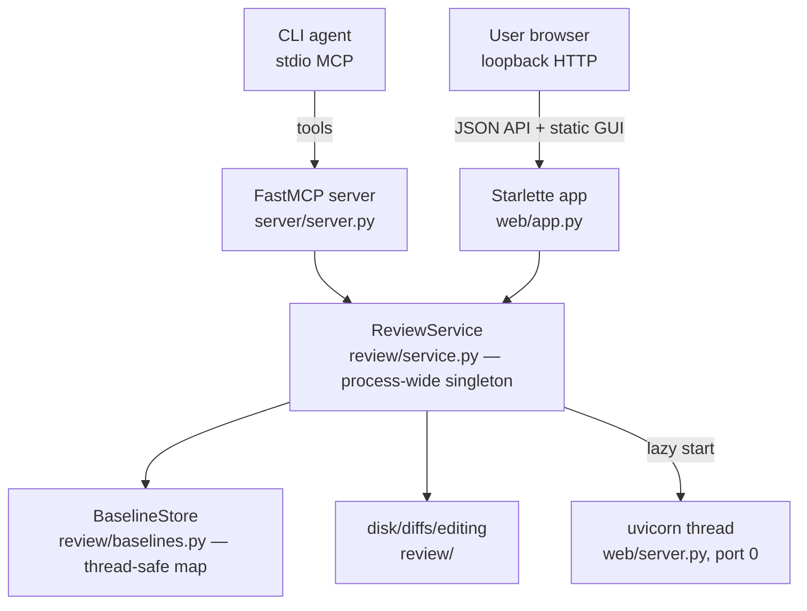
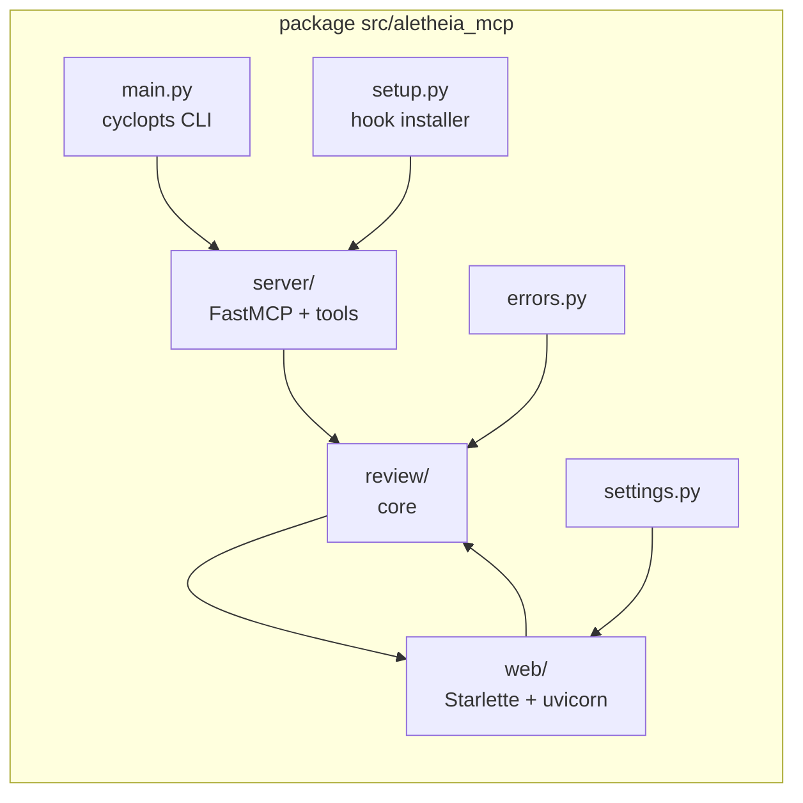

# Architecture — aletheia

<!-- tags: architecture, design, invariants -->

## Overview

Aletheia is a single Python process with two front doors that share one
in-memory `ReviewService`:

- The **MCP server** (`server/server.py`) is built on import but starts no
  transport until `run()` calls `mcp.run(transport="stdio")`. Tools register
  themselves on the `mcp` instance via decorators in `server/tools/`.
- The **review web server** (`web/server.py`) is a uvicorn server in a daemon
  thread, started **lazily** by `ensure_running()` on the first baseline
  recording. It binds port 0 (OS-assigned free port) on `ALETHEIA_HOST`
  (default `127.0.0.1`), so the URL is constant for the process lifetime and
  needs no configuration.
- The **Starlette app** (`web/app.py`) serves the committed GUI bundle from
  `src/aletheia_mcp/webui/dist` at `/review` plus a JSON API under `/api/`.
  A `LoopbackGuard` middleware rejects mutating API calls that are not
  `application/json` or that carry a non-loopback Origin/Referer.

## Design invariants

<!-- tags: invariants -->

1. **Live diff.** The baseline holds a pre-edit snapshot; every diff/status
   is computed against the *current* working-directory content at request
   time, so the review page never goes stale while the agent keeps editing.
2. **One process-wide baseline.** `get_service()`/`set_service()` manage a
   singleton `ReviewService`; MCP tools and HTTP handlers both delegate to it,
   so a browser decision reaches the agent's next `get_change_status()` poll.
   An entry exists only while its file is under review.
3. **Lazy, autodetected web server.** Nothing binds a port until the first
   baseline; `ensure_running` is idempotent and returns the same URL.
4. **Trusted root confinement.** The `edit` tool resolves `file_path`
   (following symlinks) and requires containment in the trusted root — the git
   repository root of the CWD at server start, computed once per process —
   matching the Vibe CLI filesystem-safety criterion.
5. **Atomic disk effects.** `review/disk.py` is the only module that writes
   or deletes files; writes use a temp file in the same directory plus
   `os.replace`, and the server never creates parent directories.
6. **No side effects on failure.** The `edit` tool validates everything
   (trusted root → read/validate → baseline registration → atomic write) so a
   failed change leaves no phantom baseline entry.
7. **UTF-8 text only.** Directories and non-UTF-8 files are not reviewable;
   errors name the offending path.
8. **Agent-facing errors.** Every domain error in `errors.py` is written for
   an LLM: it names the offending value and the recovery action.

## Module map

<!-- tags: module-map -->

| Module | Role |
| --- | --- |
| `main.py` | cyclopts CLI: default command runs the MCP server (stdio); `setup` installs the Vibe hook |
| `server/server.py` | FastMCP instance + `run()`; instructions string is the agent protocol summary |
| `server/tools/review_tools.py` | the five review MCP tools |
| `server/tools/system.py` | `ping` health tool |
| `review/service.py` | `ReviewService`: the seam between tools/HTTP and the core; process-wide singleton |
| `review/baselines.py` | `Baseline` (content `None` = creation marker), `BaselineStore`, `read_text_or_none` |
| `review/diffs.py` | `unified_diff` with `<created>`/`<deleted>` edge markers, `has_text_change` |
| `review/disk.py` | atomic `write_text` / `delete`; the only module touching the filesystem for effects |
| `review/editing.py` | `trusted_root`, `contains`, `apply_edit` (edit + create + auto-baseline) |
| `web/app.py` | Starlette routes, `LoopbackGuard`, error→status mapping, fallback index page |
| `web/server.py` | `ensure_running(settings)` — lazy uvicorn daemon thread, port 0, constant URL |
| `settings.py` | pydantic-settings `Settings` (`ALETHEIA_HOST`), process singleton |
| `errors.py` | domain error hierarchy rooted at `AletheiaError` |
| `setup.py` | `git_root`, `install_hook` — writes `.vibe/hooks.toml` + `.vibe/hooks/aletheia_baseline.py` |
| `webui/dist/` | committed built GUI bundle (generated; never hand-edit) |
