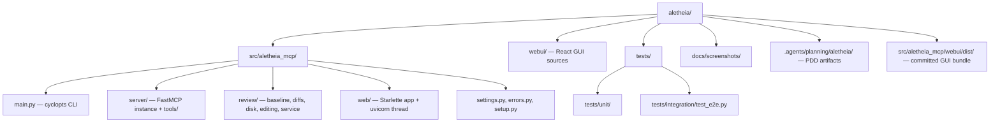

# Codebase info — aletheia

<!-- tags: overview, identity, layout, tooling -->

## What this is

**Aletheia** (ἀλήθεια, "unconcealment") is an MCP server that gives terminal
coding agents (such as the Mistral Vibe CLI) the Zed-style **asynchronous
change review** workflow: the agent records a baseline before editing, the
user reviews the live diff in a local loopback web GUI, and approves or
rejects per file — without blocking the agent conversation.

It lives in the `aletheia/` subproject of the `epinoia` monorepo
(epinoia is demiourgoi's internal toolkit of agent skills and configs; the
repository-root `AGENTS.md` describes the monorepo, this file covers only
`aletheia/`).

## Stack

<!-- tags: stack, languages -->

- **Python 3.14** (pinned: `requires-python = ">=3.14,<3.15"`,
  `.python-version`), managed with **uv** (`uv.lock` committed).
- **FastMCP** for the MCP server (stdio transport), **cyclopts** for the CLI,
  **pydantic-settings** for `ALETHEIA_*` env config, **Starlette + uvicorn**
  for the loopback review web server.
- **React 18 + TypeScript + Vite + CodeMirror 6 (merge view)** for the review
  GUI in `webui/`; the built bundle is committed into
  `src/aletheia_mcp/webui/dist` so the wheel ships the GUI without Node.
- **pytest** for tests (unit + a real-server end-to-end test; loopback only,
  no network), **mypy** (strict-ish: `disallow_untyped_defs`, untyped defs
  checked) and **ruff** (target `py314`, line length 120) for lint/format.
- Build backend: **hatchling**; wheel package is `src/aletheia_mcp`.

## Directory layout

<!-- tags: layout -->

Key files at the root: `pyproject.toml` (package + tool config),
`Makefile` (install/webui/check/test/run), `README.md` (user-facing),
`DEVELOPER_GUIDE.md` (architecture and protocol), `CONTRIBUTING.md`,
`LICENSE` (MIT), `uv.lock`.

## Commands

<!-- tags: commands, tooling -->

Run from `aletheia/`:

| Command | Purpose |
| --- | --- |
| `make install` | `uv sync` — create the Python 3.14 environment |
| `make check` | `uv lock --locked` + mypy + ruff check/format |
| `make test` | `uv run python -m pytest` (unit + loopback e2e) |
| `make webui` | Build the GUI (`npm ci && npm run build`) into `src/aletheia_mcp/webui/dist` and copy license sidecars |
| `make run` | Run the CLI from the checkout (`uv run aletheia`) |
| `uvx --from aletheia aletheia` | Run the server without the checkout (once published) |
| `aletheia setup [--global]` | Install the Vibe baseline-reminder hook |

## Repo-specific gotchas

<!-- tags: gotchas -->

1. **Python 3.14 is required, not optional.** `setup.py` uses the 3.14
   parenthesised-optional `except` clause (`except A, B, C:`); under ≤3.13 the
   module fails to import. Keep the pin.
2. **Never hand-edit `src/aletheia_mcp/webui/dist`.** The committed bundle is
   generated by `make webui` from `webui/`; edit the sources and rebuild.
3. **The review web server is lazy and port-autodetected.** Nothing binds a
   port until the first baseline is recorded; `web/server.py` binds port 0.
   There is deliberately no port configuration.
4. **State is in-memory and per-process.** One baseline per agent
   conversation; approve/reject drop entries. Tests replace the singleton via
   `set_service`.
5. **The `edit` tool is confined to the trusted root** — the git root of the
   CWD at server start — resolved after symlinks, computed once per process.
6. **Only UTF-8 text files are reviewable.** Directories and non-UTF-8 files
   raise `UnsupportedFileError` naming the path.
7. **The server never creates parent directories** on write (atomic
   `os.replace` in the target's own directory).
8. **Mutating HTTP API calls are guarded** (`LoopbackGuard`): they require
   `Content-Type: application/json` and loopback Origin/Referer, to stop
   cross-origin `no-cors` POSTs from a browser page.
9. Design docs and the implementation plan live in
   `.agents/planning/aletheia/`; the PDD skill (repo-root `skills/pdd`)
   governs changes that touch the design. Commits use the lowercase scope
   prefix `aletheia: ...`.
10. Third-party GUI components (React, CodeMirror 6, Vite) are tracked in the
    repository-root `THIRD-PARTY-NOTICES.md` / `REUSE.toml`; the GUI bundle
    carries a `LICENSE` sidecar copied by `make webui`.
