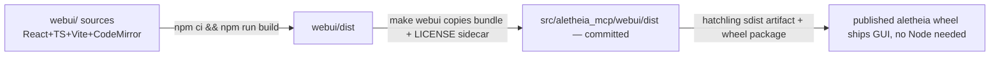

# Workflows — aletheia

<!-- tags: workflows, flows -->

## 1. The async review flow (happy path)

```mermaid
sequenceDiagram
    participant A as CLI agent
    participant M as MCP server (stdio)
    participant S as ReviewService
    participant W as loopback web GUI
    participant U as User
    A->>M: record_baseline([f1, f2])
    M->>S: snapshot pre-edit content (missing file -> creation marker)
    S->>W: ensure_running() starts uvicorn on a free port (first call only)
    M-->>A: {"url", "recorded", "marked_for_creation"}
    A->>U: show the constant URL
    A->>A: edits files on disk (any tool), runs linters/tests
    U->>W: opens /review; page polls GET /api/review
    W->>S: review_payload() = baseline vs current disk, live unified diffs
    U->>W: Approve file -> DELETE /api/baseline/files
    U->>W: or Reject file -> POST /api/rollback (restores baseline on disk; created file deleted)
    U->>W: or edits right pane + Save edit -> POST /api/content
    A->>M: get_change_status() poll
    M-->>A: live drift; decided files are gone from the baseline
    Note over A,U: agent edits a decided file again -> record_baseline anchors a new round
```

Key properties: the diff never goes stale (computed against current disk at
request time); the URL is constant for the process; state is in-memory and
per conversation.

## 2. The `edit` tool flow (baseline-aware replacement for edit + write_file)

```mermaid
graph TD
    A[edit(file_path, old_string, new_string, replace_all)] --> B[resolve file_path<br>relative to trusted root, follow symlinks]
    B --> C{inside trusted root?}
    C -- no --> X[OutsideTrustedRootError]
    C -- yes --> D[read current UTF-8 text]
    D --> E{file exists?}
    E -- no --> F[creation semantics:<br>require old_string = "" and non-empty new_string]
    F --> G[register creation-marker baseline if absent]
    G --> H[atomic write; on failure remove the fresh entry]
    E -- yes --> I[edit semantics:<br>old_string non-empty, != new_string,<br>unique match unless replace_all]
    I --> J[register pre-change baseline if absent]
    J --> H
    H --> K[{"file", "message", "created", "baseline_registered", "url"}]
```

No side effects on failure: all validation happens before the baseline
registration and the atomic write, and a failed write removes a freshly
registered entry so a never-changed file never appears under review.

## 3. Reject (rollback) flow

`rollback_to_baseline(paths)` resolves and dedupes paths, then under a lock:
prechecks every entry (all must be in the baseline — a missing one fails the
whole call before any disk effect, so a change set is never half-rejected),
writes each baseline content back atomically (or deletes creation-marked
files), and removes each entry. The file is then out of review; editing it
again requires `record_baseline`.

## 4. Hook installation (`aletheia setup`)

```mermaid
graph TD
    A[aletheia setup dir --global?] --> B{--global?}
    B -- yes --> C[base = ~/.vibe]
    B -- no --> D[base = git_root(dir) or dir]
    C --> E[install_hook(base)]
    D --> E
    E --> F[mkdir .vibe/hooks]
    F --> G[append [[hooks]] aletheia-baseline to .vibe/hooks.toml<br>only if the name is absent — merge-safe, idempotent]
    G --> H[write .vibe/hooks/aletheia_baseline.py]
    H --> I[print installed hooks.toml path]
```

Placement rule: project-level hooks go to the `.vibe/` of the **git
repository root**, not the CWD, because Vibe loads project configuration from
the repo root (same discovery rule epinoia applies to `.opencode/` files).

## 5. GUI build and packaging flow



`make webui` also copies `webui/dist-sidecar/LICENSE` and
`webui/dist-sidecar/assets/README.md` into the bundle. Never hand-edit the
dist; edit `webui/` sources and rebuild.

## 6. Test flow

`make test` → `uv run python -m pytest` over `tests/`:

- Unit tests use the `service` fixture (`tests/conftest.py`): `chdir` to
  `tmp_path`, stub `web_server.ensure_running` to a fixed URL, install a fresh
  `ReviewService(trusted_root=tmp_path)` via `set_service`.
- `tests/integration/test_e2e.py` uses the **real** FastMCP client, the real
  loopback uvicorn server (port 0), and real disk effects in `tmp_path`:
  record baseline for an existing and a to-be-created file → edit on disk →
  verify live diff over HTTP → user edit via `POST /api/content` + approve via
  `DELETE /api/baseline/files` (tweak stays on disk) → reject the created file
  via `POST /api/rollback` (file deleted) → final `get_change_status` empty,
  URL unchanged. Loopback sockets only; no external network.
