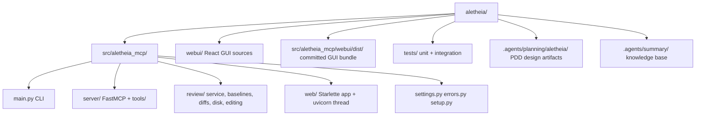

# aletheia — AGENTS.md

<!-- auto-generated by codebase-summary; full knowledge base in .agents/summary/index.md -->

This file is the agent-oriented entry point to the `aletheia/` subproject of
the epinoia monorepo. If the answer to a question is not on this page — full
workflows, file formats, interface details — open
[`.agents/summary/index.md`](.agents/summary/index.md) first; it routes to the
detailed knowledge base files. The **Custom Instructions** section at the end
is human-maintained and authoritative for project context and conventions.

## Table of Contents

- [Knowledge base](#knowledge-base) — where to go when this page doesn't have the answer
- [Codebase at a glance](#codebase-at-a-glance) — what aletheia is and how its pieces fit
- [Directory organization](#directory-organization) — where the code, GUI, tests, and docs live
- [Key entry points](#key-entry-points) — how work starts
- [Repo-specific conventions and gotchas](#repo-specific-conventions-and-gotchas) — behavior-changing details agents must know
- [Repo-specific commands](#repo-specific-commands) — the Makefile-driven workflow
- [Custom Instructions](#custom-instructions) — human-maintained project context (preserved across refreshes)

## Knowledge base

<!-- tags: knowledge-base, routing -->

If this page doesn't answer your question, open
[`.agents/summary/index.md`](.agents/summary/index.md) — it is the routing
table for everything else: `codebase_info.md` (identity/stack/layout),
`architecture.md` (process model and invariants), `components.md` (per-module
responsibilities), `interfaces.md` (MCP tools, HTTP API, hook, CLI — exact
shapes), `data_models.md` (baseline, payloads, errors), `workflows.md`
(end-to-end flows), `dependencies.md` (why each dependency), and
`review_notes.md` (known documentation gaps).

## Codebase at a glance

<!-- tags: overview, stack -->

- **What**: `aletheia` (ἀλήθεια, "unconcealment") is an MCP server giving
  terminal coding agents (e.g. Mistral Vibe CLI) the Zed-style
  **asynchronous change review** workflow: the agent records a baseline
  before editing, the user reviews the live diff in a loopback web GUI, and
  approves or rejects per file — without blocking the conversation.
- **Stack**: Python 3.14 (pinned, managed with `uv`) with FastMCP (stdio MCP
  server), cyclopts (CLI), pydantic-settings (`ALETHEIA_*` env vars),
  Starlette + uvicorn (loopback review server, OS-assigned port); the review
  GUI is React 18 + TypeScript + Vite + CodeMirror 6 in `webui/`, built and
  committed into `src/aletheia_mcp/webui/dist` so the wheel ships it without
  Node. Tests: pytest (unit + real-server loopback e2e); gates: mypy + ruff.
- **Packaging**: hatchling; wheel package `src/aletheia_mcp`; console script
  `aletheia = aletheia_mcp.main:app`. Original code is MIT.

See: [`.agents/summary/codebase_info.md`](.agents/summary/codebase_info.md), [`.agents/summary/dependencies.md`](.agents/summary/dependencies.md).

## Directory organization

<!-- tags: navigation, layout -->



- `src/aletheia_mcp/main.py` — cyclopts CLI: default runs the MCP server
  (stdio); `setup` installs the Vibe hook.
- `src/aletheia_mcp/server/` — the FastMCP instance (`server.py`) and the tool
  definitions (`tools/review_tools.py`, `tools/system.py`).
- `src/aletheia_mcp/review/` — the core: `service.py` (process-wide
  `ReviewService` singleton shared by MCP tools and HTTP), `baselines.py`
  (thread-safe store; `content=None` = creation marker), `diffs.py`,
  `disk.py` (the only module that writes/deletes; atomic `os.replace`),
  `editing.py` (trusted-root confinement + the baseline-aware `edit`).
- `src/aletheia_mcp/web/` — `app.py` (Starlette routes, `LoopbackGuard`,
  `/review` page + `/api/*` JSON) and `server.py` (lazy uvicorn daemon
  thread, port 0, constant URL).
- `src/aletheia_mcp/webui/dist/` — generated GUI bundle; never hand-edit.
- `webui/` — GUI sources (Vite + React + CodeMirror 6 merge view).
- `tests/unit/`, `tests/integration/test_e2e.py` — pytest suites;
  `tests/conftest.py` provides an isolated `service` fixture.
- `.agents/planning/aletheia/` — PDD design docs and plan (historical).

See: [`.agents/summary/components.md`](.agents/summary/components.md).

## Key entry points

<!-- tags: entry-points -->

- **`src/aletheia_mcp/main.py`** — `aletheia` CLI (`app`); default command
  `run()` starts the MCP server on stdio; `setup [dir] [--global]` installs
  the Vibe baseline-reminder hook at the git root.
- **`src/aletheia_mcp/server/server.py`** — builds the `mcp` FastMCP instance
  on import (no transport until `run()`); its `instructions` string is the
  agent-facing protocol summary.
- **`src/aletheia_mcp/server/tools/review_tools.py`** — the MCP tools:
  `record_baseline`, `get_change_status`, `remove_from_baseline` (approve),
  `rollback_to_baseline` (reject), `edit` (baseline-aware replacement for the
  built-in `edit` + `write_file`).
- **`src/aletheia_mcp/review/service.py`** — `ReviewService` and the
  `get_service`/`set_service` process-wide singleton both transports use.
- **`src/aletheia_mcp/web/app.py` / `web/server.py`** — the loopback review
  GUI: `/review` page, `/api/review`, `/api/baseline/files` (POST/DELETE),
  `/api/rollback`, `/api/content`; started lazily on first baseline.
- **`tests/integration/test_e2e.py`** — real FastMCP client + real loopback
  server + real disk effects; the reference for the whole workflow.
- User-facing docs: `README.md` (setup with Vibe), `DEVELOPER_GUIDE.md`
  (architecture + tool protocol), `CONTRIBUTING.md`.

See: [`.agents/summary/interfaces.md`](.agents/summary/interfaces.md), [`.agents/summary/workflows.md`](.agents/summary/workflows.md).

## Repo-specific conventions and gotchas

<!-- tags: conventions, gotchas -->

1. **Python 3.14 is a hard requirement.** `setup.py` uses 3.14's
   parenthesised-optional `except A, B, C:`; under ≤3.13 the module fails to
   import. Keep the pin (`requires-python`, `.python-version`).
2. **Never hand-edit `src/aletheia_mcp/webui/dist`.** It is generated by
   `make webui` from `webui/`; edit sources and rebuild, then commit the
   bundle (the wheel ships it without Node).
3. **The review web server is lazy and port-autodetected.** Nothing binds a
   port until the first baseline; `web/server.py` binds port 0 and the URL is
   constant for the process. There is deliberately no port configuration
   (`ALETHEIA_HOST`, default `127.0.0.1`, is the only setting).
4. **State is in-memory and per-process.** One baseline per agent
   conversation; approve/reject drop entries; re-recording anchors a new
   round. Tests isolate via `set_service` and the `service` fixture.
5. **The `edit` tool is confined to the trusted root** — the git root of the
   CWD at server start — checked after symlink resolution, computed once per
   process. It replaces **both** built-in `edit` and `write_file`; hosts
   disable those two (`disabled_tools = ["edit", "write_file"]`), and the
   reminder hook from `aletheia setup` is only a best-effort fallback.
6. **Only UTF-8 text files are reviewable**; directories and binaries raise
   `UnsupportedFileError` naming the path. The server never creates parent
   directories on write (atomic temp-file + `os.replace` in the target's own
   directory).
7. **Mutating `/api/*` calls are guarded** (`LoopbackGuard`): they need
   `Content-Type: application/json` and loopback Origin/Referer, so a browser
   page cannot drive the review API cross-origin with `no-cors`.
8. **Error messages are written for agents**: every domain error in
   `errors.py` names the offending value and the recovery action; the MCP
   tool docstrings are the agent's manual.
9. **`aletheia setup` installs at the git repository root**, not the CWD,
   because Vibe loads project hooks from the repo root (same discovery rule
   epinoia applies to `.opencode/` files). Installation is merge-safe and
   idempotent (keyed on the `aletheia-baseline` hook name).
10. **Design changes are PDD-governed**: design docs and the implementation
    plan live in `.agents/planning/aletheia/`; the repo-root `skills/pdd`
    skill governs changes that touch the design. Commits use the lowercase
    scope prefix `aletheia: ...`.
11. **GUI third-party components** (React, CodeMirror 6, Vite — MIT) are
    tracked in the repository-root `THIRD-PARTY-NOTICES.md` / `REUSE.toml`;
    the dist bundle carries a `LICENSE` sidecar copied by `make webui`.

## Repo-specific commands

<!-- tags: commands -->

Run from `aletheia/`:

| Command | Purpose |
| --- | --- |
| `make install` | `uv sync` — create the Python 3.14 environment |
| `make check` | `uv lock --locked` + mypy + ruff check/format |
| `make test` | `uv run python -m pytest` (unit + real-server loopback e2e) |
| `make webui` | Build the GUI from `webui/` into the committed `src/aletheia_mcp/webui/dist` (+ license sidecars) |
| `make run` | Run the `aletheia` CLI from the checkout (`uv run aletheia`) |
| `uvx --from epinoia-aletheia aletheia` | Run the server without the checkout (once published) |
| `aletheia setup [--global]` | Configure Vibe: MCP server, disable built-in `edit`/`write_file`, add the `AGENTS.md` editing policy |
| `aletheia setup --legacy-hook` | Install the old best-effort reminder hook instead (not recommended) |

## Custom Instructions

<!-- This section is maintained by developers and agents during day-to-day work.
     It is NOT auto-generated by codebase-summary and MUST be preserved during refreshes.
     Add project-specific conventions, gotchas, and workflow requirements here. -->

### Running `uv`, `uvx`, and `make` here

The default uv cache directory is not writable in this environment, so `uv`
and `uvx` fail with "authorization channel closed". Point `UV_CACHE_DIR` at a
writable path inside `.local/` (gitignored) for every uv command:

```console
UV_CACHE_DIR=.local/uv-cache make check
UV_CACHE_DIR=.local/uv-cache make test
UV_CACHE_DIR=.local/uv-cache uv run aletheia setup --global
UV_CACHE_DIR=.local/uv-cache env -u VIRTUAL_ENV uvx --from epinoia-aletheia aletheia --help
```

A `uvx` / `uv tool run` environment is cached by requirement, not by wheel
contents. When testing a wheel you just rebuilt, clear the cache (or use a
fresh `UV_CACHE_DIR`) first, or a stale environment will shadow the new build.
