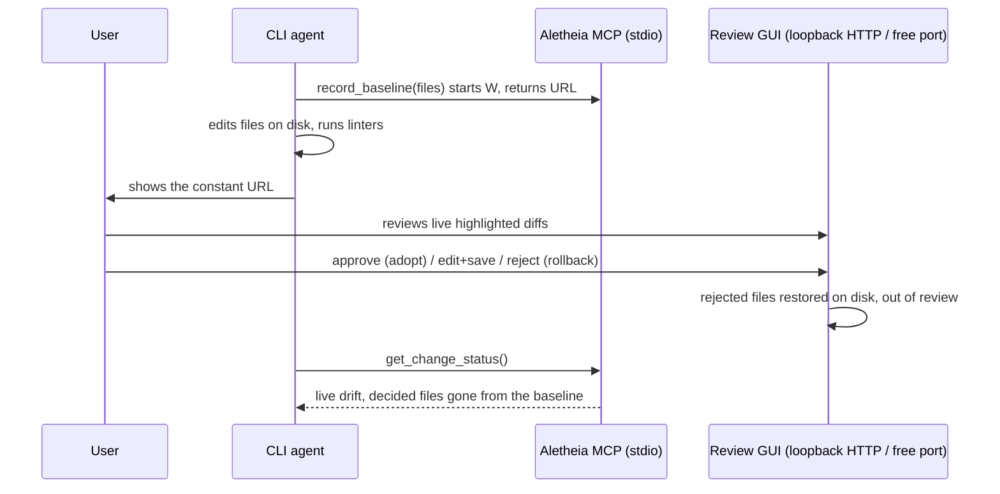
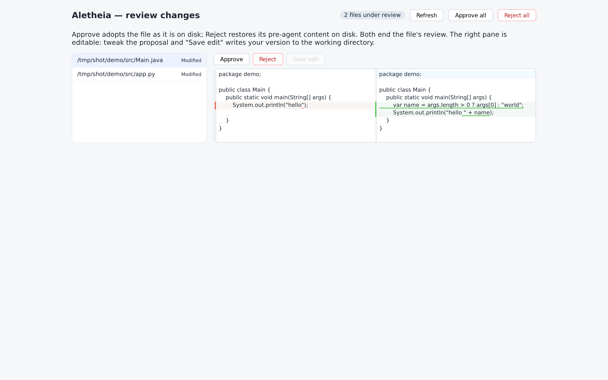
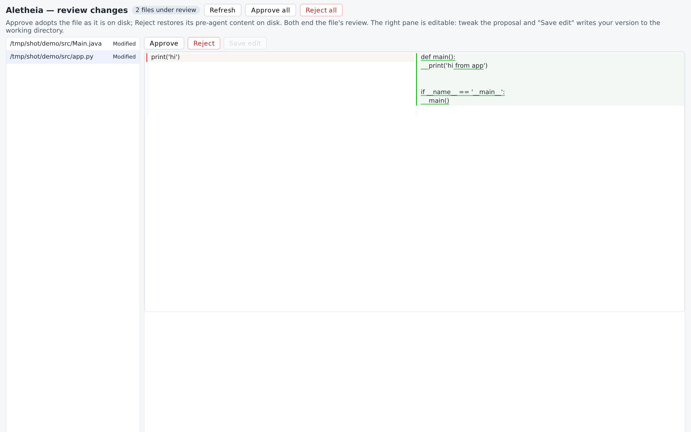

# Aletheia

**Aletheia** (ἀλήθεια: unconcealment) is an MCP server that gives terminal
coding agents (such as Mistral Vibe CLI) the Zed-style **asynchronous
change review** workflow: the agent records a baseline before editing, you
review the live diff in a local web GUI, and approve or reject per file —
without ever blocking the conversation.

1. Before editing, the agent says which files it is about to change; Aletheia
   snapshots them and opens a review page whose URL is stable for the session.
2. The agent **edits the files normally**. Changes are on disk, so linters
   and tests see them; the review page always shows the [live diff](#live-review).
3. You open the URL: a compact **side-by-side diff** per file. **Approve**
   (keep the change), **edit** then approve, or **reject** (restore the
   original content) — per file or all at once.
4. A file is under review only until you decide on it. If the agent changes
   it again later, a new review round starts.



## Live review

The review page compares each file's pre-edit snapshot with its current
content, so it never goes stale: you can run linters and tests while the
diff updates. Only UTF-8 text files can be reviewed; binaries and
directories are reported as unsupported. The review server listens on
loopback only and lives as long as the agent session.

## Screenshots

| Java file under review | Python file under review |
| --- | --- |
|  |  |

## Configuration

| Variable | Default | Meaning |
| --- | --- | --- |
| `ALETHEIA_HOST` | `127.0.0.1` | bind host of the review web GUI (loopback only by default) |

No port needs configuring: the review server picks a free port and the URL
it reports is the one to open.

## Mistral Vibe setup

There are three steps; [`aletheia setup`](#automating-the-setup) does all of
it for you. Do them by hand to install into an existing configuration, or to
see what the command writes. Background:
[Vibe configuration reference](https://docs.mistral.ai/vibe/code/cli/configuration-reference)
and [MCP servers docs](https://docs.mistral.ai/vibe/code/cli/mcp-servers).

### 1. Register the MCP server

Add one `[[mcp_servers]]` block to `~/.vibe/config.toml` (user level) or
`./.vibe/config.toml` (project level); keep the blocks already there. Set
`command` to the absolute path of your `aletheia` executable:

```toml
# https://docs.mistral.ai/vibe/code/cli/mcp-servers
[[mcp_servers]]
name = "aletheia"
transport = "stdio"
command = "/home/you/path/to/epinoia/aletheia/.venv/bin/aletheia"
args = []
env = { }
```

If you run it from PyPI with `uvx`, point `command` at `uvx` instead;
`aletheia setup` does this automatically when it runs through `uvx` (see
[Automating the setup](#automating-the-setup)):

```toml
command = "uvx"
args = ["--from", "epinoia-aletheia", "aletheia"]
```

### 2. Forbid the built-in edit and write_file tools (recommended)

Aletheia's baseline-aware **`edit`** tool replaces Vibe's **built-in `edit`
and `write_file` together**: it edits existing files (exact `old_string` →
`new_string` replacement) and creates new ones from scratch (`old_string`
empty, `new_string` the full content). Every change through it records the
review baseline automatically in the same call — an edit made this way
**cannot** skip the baseline, so nothing you would want to review goes
unreviewed.

Making it the only path is what actually enforces that. Forbid both
built-ins in the same `config.toml`:

```toml
disabled_tools = ["edit", "write_file"]
```

Vibe prefixes MCP tools with the server name, so Aletheia's tool appears as
`aletheia_edit` and is not affected by `disabled_tools`. These keys also
work in a custom agent file (`.vibe/agents/<name>.toml`) to scope the
restriction to one agent.

### 3. Add the editing policy to AGENTS.md (recommended)

Disabling the built-ins leaves the agent no *working* way to edit a file
except through Aletheia, but it does not tell the agent which tool to use
instead. Add this to `~/.vibe/AGENTS.md` (user level) or the project's
`AGENTS.md`: Vibe loads both into the agent's context
([docs](https://docs.mistral.ai/vibe/code/cli/agents#agents-md-support)),
and in testing this combination — disabled built-ins **plus** these
instructions — is what works best:

```markdown
# Aletheia: creating and editing text files

When creating or editing any plain text file:

- You MUST ALWAYS use the tool `aletheia_edit` (your host may list it as `mcp_aletheia.edit`)
- If the tool errors, report the failure rather than editing by other means
- You MUST ALWAYS suggest that the user review the changes at the URL the edit tool returns
```

Adding it to the project's `AGENTS.md` (committed to the repository) covers
everyone working in that project; `~/.vibe/AGENTS.md` covers every
project for you.

### Alternative: the reminder hook (does not work as well)

Before the steps above existed, `aletheia setup` installed a `post_tool`
hook that *nudges* the agent to record files it edited by other means. It
still installs with `aletheia setup --legacy-hook`, and earns its keep for
the change channels `disabled_tools` cannot close (shell commands, other
MCP servers). **Prefer steps 2 and 3:** the hook runs in its own process
after an edit already happened, cannot see the review baseline, and only
asks the agent to fix things up, so agents frequently ignore it. Forbid the
built-ins and state the policy instead; keep the hook only as a fallback.

### Automating the setup

`aletheia setup` performs the three steps above on `config.toml` and
`AGENTS.md`:

```console
aletheia setup                    # project-level (this repository's git root)
aletheia setup --global           # user-level (~/.vibe/)
aletheia setup --legacy-hook      # the old reminder-hook fallback instead
```

Run it from inside the project you want to configure; without `--global` it
installs at the git root and reports where. Every file is edited
surgically: other MCP servers, models, comments and your own `AGENTS.md`
prose are preserved, and rerunning it changes nothing. The editing policy
in `AGENTS.md` lives between `<!-- aletheia:begin ... -->` and
`<!-- aletheia:end -->` markers and is refreshed in place, so you can edit
around it. Restart Vibe afterwards.

When `aletheia setup` itself runs through `uvx`, it registers the server
with `command = "uvx"` / `args = ["--from", "epinoia-aletheia",
"aletheia"]`, because the temporary environment `uvx` built is gone once
the command exits. Otherwise it uses the installed `aletheia` script (the
venv/`pipx` install above). It tells the two apart from the interpreter
path: a `uvx`/`uv tool run` environment always lives under a
`.../archive-v0/` cache directory.

## Using Aletheia with other MCP hosts

Any MCP host that supports stdio can launch Aletheia the same way:

```json
{
  "mcpServers": {
    "aletheia": { "command": "uvx", "args": ["--from", "epinoia-aletheia", "aletheia"] }
  }
}
```

## Development

Building, testing, architecture, and contribution notes live in
[DEVELOPER_GUIDE.md](DEVELOPER_GUIDE.md).

## License

MIT — see [LICENSE](LICENSE).
