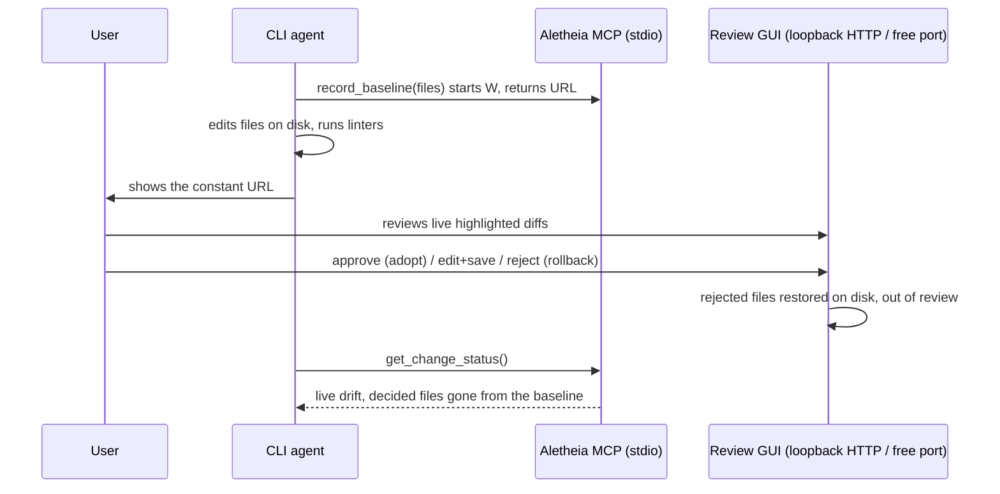

# Aletheia

**Aletheia** (ἀλήθεια: unconcealment) is an MCP server that gives terminal
coding agents (such as Mistral Vibe CLI) the Zed-style **asynchronous
change review** workflow: the agent records a baseline before editing, you
review the live diff in a local web GUI, and approve or reject per file —
without ever blocking the conversation.

1. Before editing, the agent says which files it is about to change; Aletheia
   snapshots them and opens a review page whose URL is stable for the session.
2. The agent **edits the files normally**. Changes are on disk, so linters
   and tests see them; the review page always shows the [live diff](#live-review).
3. You open the URL: a compact **side-by-side diff** per file. **Approve**
   (keep the change), **edit** then approve, or **reject** (restore the
   original content) — per file or all at once.
4. A file is under review only until you decide on it. If the agent changes
   it again later, a new review round starts.



## Live review

The review page compares each file's pre-edit snapshot with its current
content, so it never goes stale: you can run linters and tests while the
diff updates. Only UTF-8 text files can be reviewed; binaries and
directories are reported as unsupported. The review server listens on
loopback only and lives as long as the agent session.

## Screenshots

| Java file under review | Python file under review |
| --- | --- |
|  |  |

## Configuration

| Variable | Default | Meaning |
| --- | --- | --- |
| `ALETHEIA_HOST` | `127.0.0.1` | bind host of the review web GUI (loopback only by default) |

No port needs configuring: the review server picks a free port and the URL
it reports is the one to open.

## Mistral Vibe setup

Follow these three steps to use Aletheia with the Vibe CLI. Background:
[Vibe configuration reference](https://docs.mistral.ai/vibe/code/cli/configuration-reference)
and [MCP servers docs](https://docs.mistral.ai/vibe/code/cli/mcp-servers).

### 1. Register the MCP server

Append one `[[mcp_servers]]` block to `~/.vibe/config.toml` (user level) or
`./.vibe/config.toml` at the repository root (project level). Append it
rather than replacing existing blocks, and create the file if needed. Set
`command` to the absolute path of your `aletheia` executable:

```toml
# https://docs.mistral.ai/vibe/code/cli/mcp-servers
[[mcp_servers]]
name = "aletheia"
transport = "stdio"
command = "/home/you/path/to/epinoia/aletheia/.venv/bin/aletheia"
args = []
env = { }
```

If you installed from PyPI, use `uvx` instead:

```toml
command = "uvx"
args = ["--from", "aletheia", "aletheia"]
```

### 2. Install the baseline-reminder hook

The hook nudges the agent to record files before editing, so reviews are not
missed:

```console
aletheia setup            # project-level (this repository)
aletheia setup --global   # user-level (~/.vibe/)
```

Run `aletheia setup` from inside the project you want to protect; it reports
where it installed the hook.

### 3. Optionally force edits through Aletheia

To make the agent edit *only* through Aletheia's baseline-aware edit tool,
forbid Vibe's built-in one in the same `config.toml`:

```toml
disabled_tools = ["edit"]
# or, equivalently:
[tools.edit]
permission = "never"
```

These keys also work in a custom agent file (`.vibe/agents/<name>.toml`) to
scope the restriction to one agent. Keeping the reminder hook from step 2 is
still worthwhile: it also covers other ways an agent can change files
(`write_file`, shell commands).

## Using Aletheia with other MCP hosts

Any MCP host that supports stdio can launch Aletheia the same way:

```json
{
  "mcpServers": {
    "aletheia": { "command": "uvx", "args": ["--from", "aletheia", "aletheia"] }
  }
}
```

## Development

Building, testing, architecture, and contribution notes live in
[DEVELOPER_GUIDE.md](DEVELOPER_GUIDE.md).

## License

MIT — see [LICENSE](LICENSE).
